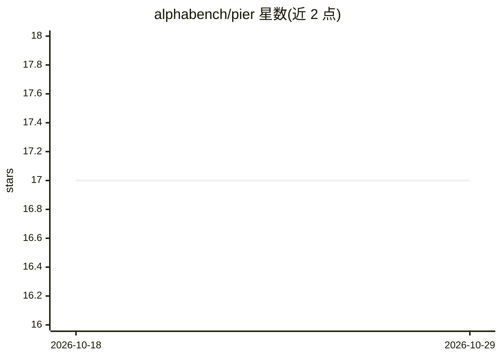

# alphabench/pier

⭐ 17 · TypeScript · NOASSERTION · 推送 2026-08-22 · [GitHub](https://github.com/alphabench/pier) · [官网](https://www.piercode.com) · 组织维护

**终端里的编码代理 CLI：用自然语言规划、改码、跑命令**

TypeScript 编写、运行于 Bun 的终端编码代理，发布为单一自包含二进制。通过交互式 REPL 或 headless 的 pier exec 执行任务：规划、编辑代码、运行命令并驱动代理工具循环，模型经由 Pier bridge 提供，也支持 BYOK 自带 API key。功能包括 plan/auto/accept-edits 等权限模式、OS 级沙箱（macOS seatbelt / Linux bubblewrap）、子代理、MCP 客户端、项目记忆（CLAUDE.md/AGENTS.md）、上下文压缩与本地会话持久化。许可证为 Business Source License 1.1（source-available）。

## 筛选速览

| 维度 | 判定 | 备注 |
|---|---|---|
| AI 角色 | `ai-native` | 本体是模型或模型工具 |
| 许可风险 | `none` | NOASSERTION |
| 部署形态 | `None` |  |
| 模型依赖 | — | README 未给出锁定关系 |
| 硬件要求 | — | 无带数字的原话,不猜 |
| 安装摩擦 | `low` | 无编译、无系统依赖或容器化 |
| 成熟度 | — | 结构信号不足 |

## 能力要点

- 单一自包含二进制，macOS/Linux 一条命令安装
- 权限模式体系与 OS 级沙箱（seatbelt/bubblewrap）
- 支持 BYOK 自带 API key 与 --local 全本地模式
- 子代理、MCP 客户端、SKILL.md 技能包与项目记忆

## 适用场景

- 在终端里用自然语言让 AI 修改代码、跑命令、管理 git 流程
- headless 方式把编码代理嵌入脚本或自动化流程
- 以 CLAUDE.md/AGENTS.md 向代理注入项目约定与规范

## 场景标签

`编码 Agent` · 领域:编码与开发

## 证据(README 行号)

> L3: **pier** is a terminal coding agent — an interactive CLI that plans, edits code, runs
> L4: commands, and drives an agentic tool loop, powered by models served through the Pier bridge
> L5: (with BYOK support). It's written in TypeScript and runs on Bun, and it

## 星数曲线

2026-10-18 17 → 2026-10-29 17（+0）

---
*卡片 v1 · prompt 1.4 · 生成 2026-10-29 · 置信度 high · 依据 README sha `df6e9f7ed719` · [字段定义](../../DATASET.md)*
