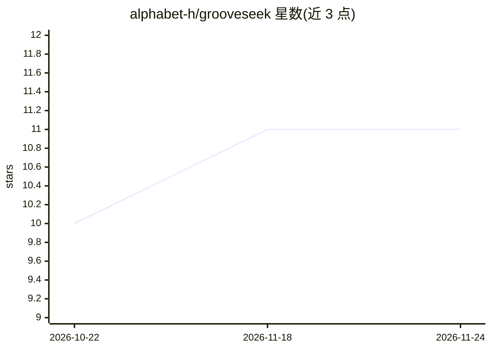

# alphabet-h/grooveseek

⭐ 11 · Rust · NOASSERTION · 推送 2026-11-22 · [GitHub](https://github.com/alphabet-h/grooveseek) · 个人维护

**面向知识库的 MCP 语义混合搜索服务器**

用 Rust 编写的 MCP 服务器，命令为 `groove`：将 Markdown（可选 txt/PDF/Office/源代码）按标题切块并生成嵌入向量，与 FTS5 全文检索结合，通过 sqlite-vec 存储于 SQLite 中进行混合搜索，并支持可选的 cross-encoder 重排序。默认使用 FastEmbed (BGE-small-en-v1.5)，支持配置 OpenAI 兼容嵌入接口或多语言模型 bge-m3。提供文件监视实时同步索引、frontmatter 校验与字段过滤、六种 MCP 工具与 `kb://` 资源，支持 stdio 与 HTTP 传输及 `/ui` 运维视图。预编译二进制需静态链接 ONNX Runtime 与 SQLite；Intel Mac 不提供预编译版本。

## 筛选速览

| 维度 | 判定 | 备注 |
|---|---|---|
| AI 角色 | `ai-ecosystem` | LLM/agent 周边工具 |
| 许可风险 | `permissive` | NOASSERTION |
| 部署形态 | `desktop` | 安装包/桌面程序 |
| 模型依赖 | — | README 未给出锁定关系 |
| 硬件要求 | — | 无带数字的原话,不猜 |
| 安装摩擦 | `medium` | 含编译或系统依赖之一 |
| 成熟度 | `idea` | |

## 能力要点

- 语义 + FTS5 全文的混合搜索，可选 cross-encoder 重排序
- 六种 MCP 工具与 `kb://` 资源，支持 stdio/Streamable HTTP 传输
- 文件监视实时同步索引，frontmatter 校验与字段过滤
- 多语言支持 bge-m3 模型，多平台预编译二进制分发

## 适用场景

- 为个人 Markdown 笔记库提供 MCP 客户端可查询的语义检索
- 团队内网通过 HTTP 传输共享同一知识库检索服务
- 在 Rust/Python/PHP 代码库中按定义粒度检索源码

## 场景标签

`语义搜索` · 领域:知识与检索

## 证据(README 行号)

> L5: MCP server for hybrid (semantic + full-text) search over a knowledge base of
> L18: Parses Markdown (and optionally `.txt` / `.pdf` / `.docx` / `.xlsx` / `.pptx`, plus Rust source since v1.2.0, and P

## 星数曲线

2026-10-22 10 → 2026-11-24 11（+1）

---
*卡片 v1 · prompt 1.4 · 生成 2026-11-18 · 置信度 high · 依据 README sha `0304ecc68b46` · [字段定义](../../DATASET.md)*
