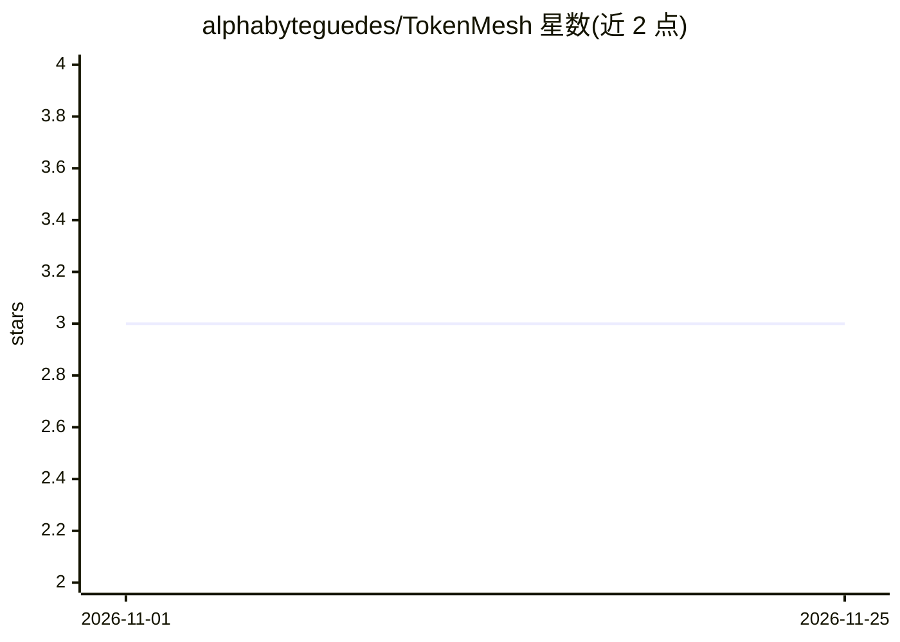

# alphabyteguedes/TokenMesh

⭐ 3 · Python · Apache-2.0 · 推送 2026-10-25 · [GitHub](https://github.com/alphabyteguedes/TokenMesh) · [官网](https://alphabyteguedes.github.io/TokenMesh/) · 组织维护

**自托管 AI 网关：语义缓存、DLP 与多协议路由降低 LLM 调用成本**

自托管的开源反向代理网关，位于应用与 LLM 提供方之间：以 DuckDB+HNSW 实现本地语义缓存（毫秒级命中返回缓存响应），原生支持 OpenAI 与 Anthropic 两种 API 协议并可跨协议转换模型路由，内置零信任 DLP 在请求到达提供方前掩蔽 CPF/CNPJ/邮箱/信用卡/API key，附带 FinOps 成本追踪仪表盘（多币种、多语言）与遥测响应头。全部组件本地运行，无需 Redis/Postgres 等外部服务。要求 Python 3.11+，提供 Docker 与本地源码两种运行方式。README 中的成本降幅与压缩比例为其自述数字。

## 筛选速览

| 维度 | 判定 | 备注 |
|---|---|---|
| AI 角色 | `ai-ecosystem` | LLM/agent 周边工具 |
| 许可风险 | `permissive` | Apache-2.0 |
| 部署形态 | `self-host` | docker 或自建部署 |
| 模型依赖 | locked-api |  |
| 硬件要求 | — | 无带数字的原话,不猜 |
| 安装摩擦 | `low` | 无编译、无系统依赖或容器化 |
| 成熟度 | — | 结构信号不足 |

## 能力要点

- DuckDB+HNSW 本地语义缓存，命中请求返回缓存响应
- 原生支持 OpenAI 与 Anthropic 双协议并自动转换路由
- 本地 DLP 管线掩蔽 CPF、CNPJ、邮箱、信用卡与 API key
- FinOps 仪表盘与遥测响应头追踪成本与缓存行为

## 适用场景

- 为现有 OpenAI/Anthropic SDK 应用透明加入缓存与成本控制
- 在提示发送到提供方前自动掩蔽敏感个人数据
- 通过 OpenAI SDK 调用 Claude 系列模型
- 按模型/按天统计 LLM 支出并做多币种核算

## 场景标签

`模型网关` · 领域:Agent 开发

## 证据(README 行号)

> L2:  AI Gateway & Semantic Reverse Proxy
> L11: **TokenMesh** is a self-hosted AI gateway and semantic reverse proxy that sits between your applications and LLM pr
> L27: - 🔀 **Dual Protocol** — Native support for both OpenAI (`/v1/chat/completions`) and Anthropic (`/v1/messages`) API 

## 星数曲线

2026-11-01 3 → 2026-11-25 3（+0）

---
*卡片 v1 · prompt 1.4 · 生成 2026-11-22 · 置信度 high · 依据 README sha `7b035c6fc554` · [字段定义](../../DATASET.md)*
