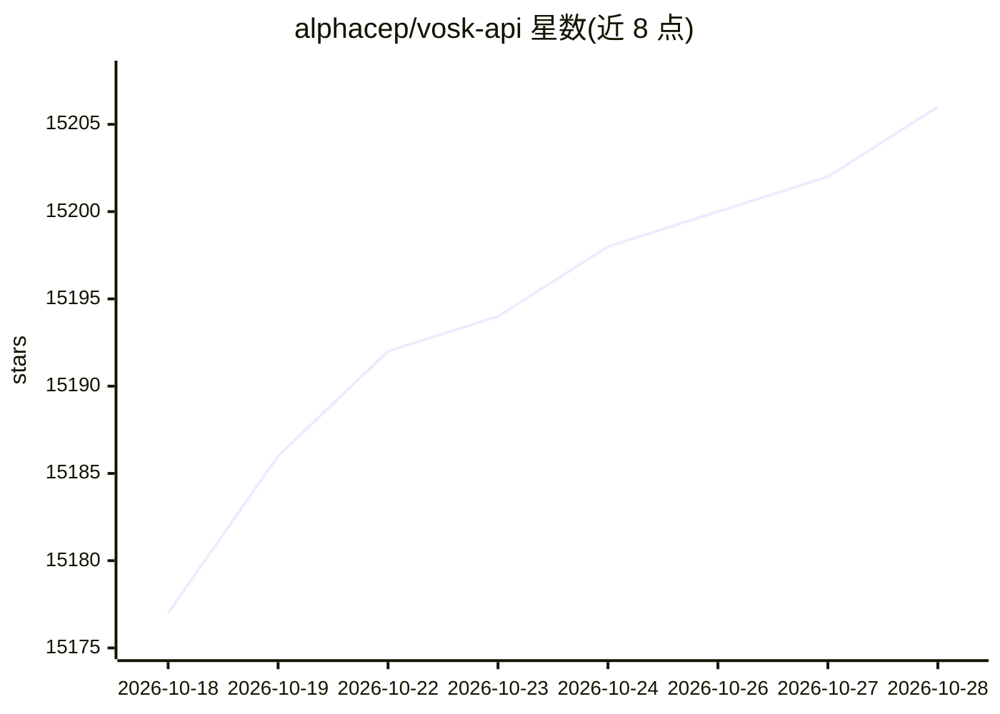

# alphacep/vosk-api

⭐ 15,206 · Jupyter Notebook · Apache-2.0 · 推送 2026-10-15 · [GitHub](https://github.com/alphacep/vosk-api) · 组织维护

**离线语音识别工具包：面向 20+ 语言的开发者 API**

Vosk 是一个离线开源语音识别工具包，支持 20 多种语言和方言的语音识别。模型体积小（50 MB），提供连续大词汇量转写、流式 API 零延迟响应、可重配置词汇表与说话人识别。为 Python、Java、Node.js、C#、C++、Rust、Go 等语言提供绑定，可从树莓派、Android 手机扩展到大型集群，安装文档位于官网。

## 筛选速览

| 维度 | 判定 | 备注 |
|---|---|---|
| AI 角色 | `ai-ecosystem` | LLM/agent 周边工具 |
| 许可风险 | `permissive` | Apache-2.0 |
| 部署形态 | `None` |  |
| 模型依赖 | — | README 未给出锁定关系 |
| 硬件要求 | — | 无带数字的原话,不猜 |
| 安装摩擦 | `low` | 无编译、无系统依赖或容器化 |
| 成熟度 | — | 结构信号不足 |

## 动量与使用信号

- 维护:`active` — 距上次 push 3.0 天,年发版 0,49 位贡献者
- 涨星:近 1 天 **+0**(自 20261016 起算)
- 下载:GitHub Release 附件 累计 2,800,690(20 个 release)
- 平台:ANDROID · 协议:—

## 能力要点

- 支持 20+ 语言的离线语音识别
- 小体积模型（50 MB）支持流式 API 与说话人识别
- 多语言绑定：Python、Java、Node.js、C#、C++、Rust、Go
- 可运行于树莓派/Android 至大型集群

## 适用场景

- 为聊天机器人或智能家居设备接入离线语音识别
- 为视频自动生成字幕
- 讲座与访谈的离线转写

## 场景标签

`语音识别` · 领域:感知与多模态

## 证据(README 行号)

> L3: Vosk is an offline open source speech recognition toolkit. It enables
> L14: Speech recognition bindings implemented for various programming languages
> L21: Vosk scales from small devices like Raspberry Pi or Android smartphone to

## 星数曲线

2026-10-18 15,177 → 2026-10-28 15,206（+29）

---
*卡片 v1 · prompt 1.4 · 生成 2026-10-18 · 置信度 high · 依据 README sha `60f14d2e8370` · [字段定义](../../DATASET.md)*
