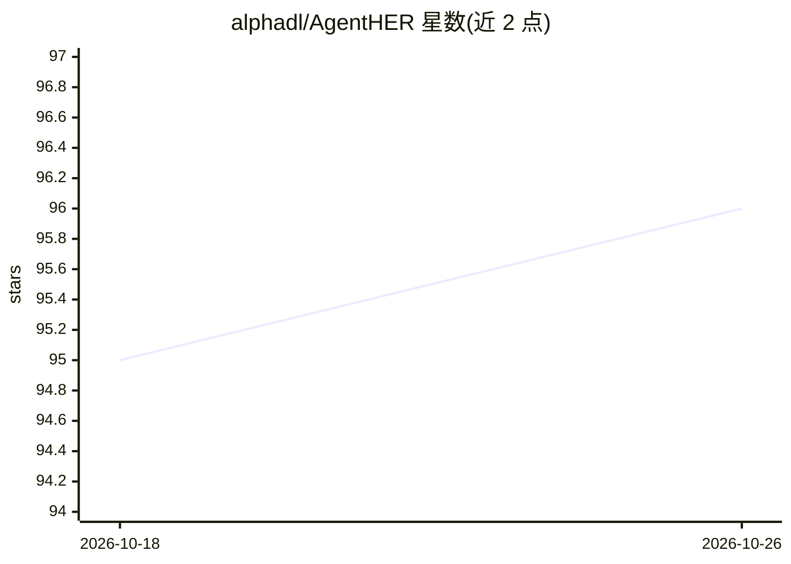

# alphadl/AgentHER

⭐ 96 · Python · Apache-2.0 · 推送 2026-03-25 · [GitHub](https://github.com/alphadl/AgentHER) · 个人维护

**将失败的 LLM Agent 轨迹重标注为可用训练数据的 Python 工具**

借鉴强化学习中 Hindsight Experience Replay 思想的数据增强库：读取失败的 agent 工具调用轨迹，经失败检测、结果提取、提示词重标注、数据打包四阶段流水线，把轨迹改写为满足其实际结果的 SFT/DPO/ShareGPT 格式训练数据。失败检测支持规则模式（免 LLM 调用）或 LLM-judge 模式；重标注需调用 LLM，支持 OpenAI 及兼容端点（vLLM/Ollama）。限制：批处理为串行、无配置文件加载、规则阶段为启发式。面向 LLM Agent 训练数据构建的开发者。

## 筛选速览

| 维度 | 判定 | 备注 |
|---|---|---|
| AI 角色 | `ai-ecosystem` | LLM/agent 周边工具 |
| 许可风险 | `permissive` | Apache-2.0 |
| 部署形态 | `library` | 以包/库形式分发 |
| 模型依赖 | local-ok | 支持本地模型 |
| 硬件要求 | — | 无带数字的原话,不猜 |
| 安装摩擦 | `low` | 无编译、无系统依赖或容器化 |
| 成熟度 | — | 结构信号不足 |

## 能力要点

- 四阶段流水线：失败检测→结果提取→提示词重标注→数据打包
- 规则模式无需 LLM 调用即可运行演示
- 输出 SFT、DPO（含 chosen/rejected）、ShareGPT 多轮标准格式
- 支持任意 OpenAI 兼容端点（vLLM/Ollama 自定义模型）

## 适用场景

- 把训练中失败的 agent 轨迹回收为 SFT/DPO 数据
- 离线用规则模式快速演示与验证流水线
- 接入本地模型端点批量重标注轨迹数据

## 场景标签

 · 领域:LLM Agent 训练数据/数据增强

## 证据(README 行号)

> L25: In LLM Agent training, **failed tool-use trajectories are routinely discarded**. This is wasteful — a trajectory th
> L54: **Stage 4 — Data Augmenter:** Packages the new (prompt, trajectory) pair into standard training formats: SFT, DPO (

## 星数曲线

2026-10-18 95 → 2026-10-26 96（+1）

---
*卡片 v1 · prompt 1.4 · 生成 2026-10-23 · 置信度 high · 依据 README sha `cbf749f2eb6c` · [字段定义](../../DATASET.md)*
