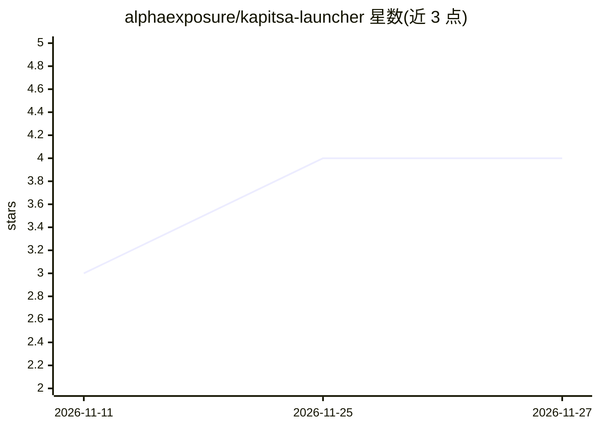

# alphaexposure/kapitsa-launcher

⭐ 4 · Swift · MIT · 推送 2026-11-10 · [GitHub](https://github.com/alphaexposure/kapitsa-launcher) · 个人维护

**运行本地 Kapitsa 模型服务器并与之聊天的 macOS 原生客户端**

面向 Apple silicon Mac 用户的非官方桌面应用：一键启动/停止/重启 Kapitsa 模型服务器、从菜单切换模型并显示下载进度，菜单栏常驻。聊天界面支持流式回复、Markdown/表格/代码格式化、思考过程折叠，并提供 Outline/Topics/Review 侧栏导航长对话，支持追问、编辑重发与版本对比，可导出含模型生成摘要的 Markdown 以便导入 Obsidian 等笔记应用。要求 macOS 14+，本身不安装或修改 Kapitsa。

## 筛选速览

| 维度 | 判定 | 备注 |
|---|---|---|
| AI 角色 | `ai-ecosystem` | LLM/agent 周边工具 |
| 许可风险 | `permissive` | MIT |
| 部署形态 | `None` |  |
| 模型依赖 | — | README 未给出锁定关系 |
| 硬件要求 | — | 无带数字的原话,不猜 |
| 安装摩擦 | `low` | 无编译、无系统依赖或容器化 |
| 成熟度 | — | 结构信号不足 |

## 能力要点

- 一键管理 Kapitsa 服务器生命周期与模型切换，菜单栏常驻
- 长对话侧栏三视图：Outline 大纲、Topics 主题、Review 要点（由模型生成）
- 支持流式回复、思考过程折叠、追问与多版本对比
- 全部本地运行，服务器仅监听 127.0.0.1:8000，聊天以 JSON 文件存储

## 适用场景

- 在 Mac 上不使用命令行运行和聊天本地大模型
- 长对话中按大纲和主题快速跳转定位
- 把带摘要和标签的对话导出为 Markdown 存入笔记应用

## 场景标签

`聊天机器人` · 领域:对话与助手

## 证据(README 行号)

> L3: A native macOS app for running a local Kapitsa model
> L14: - **Takes care of running Kapitsa.** Start, stop or restart the server with one click,
> L6: > **Unofficial.** Kapitsa Launcher is an independent project. It is not made by,

## 星数曲线

2026-11-11 3 → 2026-11-27 4（+1）

---
*卡片 v1 · prompt 1.4 · 生成 2026-11-22 · 置信度 high · 依据 README sha `bcd0ac42f34f` · [字段定义](../../DATASET.md)*
