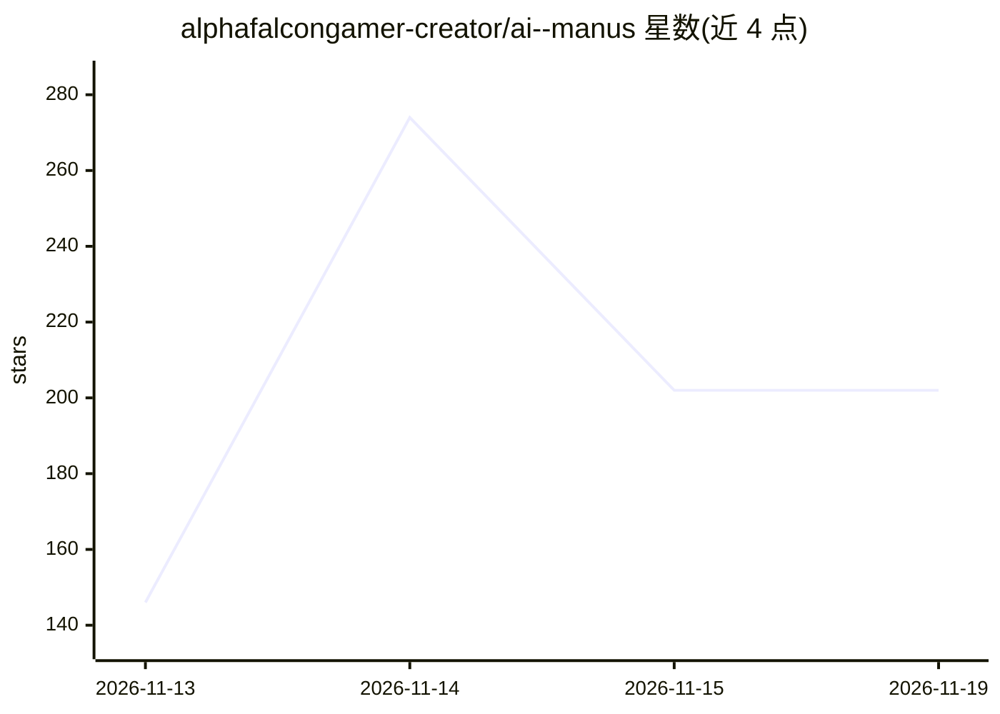

# alphafalcongamer-creator/ai--manus

⭐ 202 · Apache-2.0 · 推送 2026-11-17 · [GitHub](https://github.com/alphafalcongamer-creator/ai--manus) · 个人维护

**面向个人用户的自主 AI Agent：代写代码并控制浏览器完成任务**

以 README 自述，Manus 是自主执行任务的 AI agent：用户用自然语言下达指令，agent 自行编写并运行脚本、打开网页、填写表单、执行多步骤任务，定位为家庭、学习与轻量工作场景的个人助手，而非企业平台。README 描述其可跨会话记忆任务模式、代码与浏览器操作可衔接。README 仅给出配置使用步骤与硬件兼容表，未提供安装命令、源码入口或下载链接；L5 的 'Download Manus' 无可验证的获取途径。

## 筛选速览

| 维度 | 判定 | 备注 |
|---|---|---|
| AI 角色 | `ai-native` | 本体是模型或模型工具 |
| 许可风险 | `permissive` | Apache-2.0 |
| 部署形态 | `None` |  |
| 模型依赖 | — | README 未给出锁定关系 |
| 硬件要求 | — | 无带数字的原话,不猜 |
| 安装摩擦 | `low` | 无编译、无系统依赖或容器化 |
| 成熟度 | — | 结构信号不足 |

## 能力要点

- 自主编写并执行代码以完成任务
- 浏览器控制：导航网页、填表、采集信息
- 脚本与浏览器操作可在同一任务流中衔接
- 面向学习、家庭与轻量办公场景

## 适用场景

- 让 agent 代为执行重复的网页查询与表单填写
- 运行小脚本、整理研究笔记而不自行编程
- 远程会话中重排诊断步骤与检查系统页面

## 场景标签

`AI 助手` `浏览器自动化` `编码 Agent` · 领域:效率与自动化

## 证据(README 行号)

> L10: - **Autonomous Code Execution:** Manus AI agent runs code on its own to complete tasks, so you can focus on decisio
> L18: Manus is an autonomous AI agent designed to run code and control a browser on your behalf. Instead of acting like a
> L22: Manus is not a heavy studio suite or a complex enterprise platform. It is a focused helper built for home, study, a

## 星数曲线

2026-11-13 146 → 2026-11-19 202（+56）

---
*卡片 v1 · prompt 1.4 · 生成 2026-11-18 · 置信度 mid · 依据 README sha `32e48e22fb91` · [字段定义](../../DATASET.md)*
