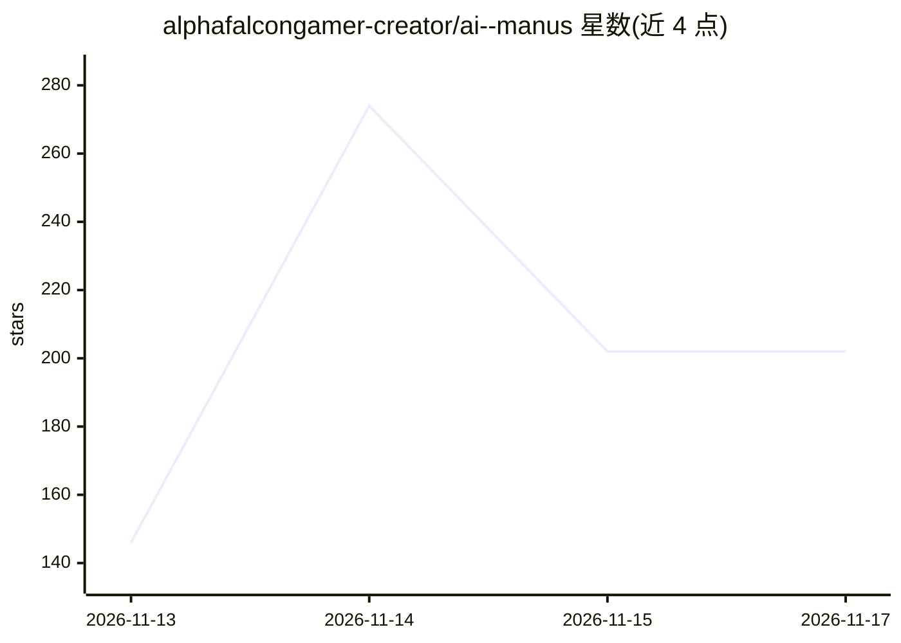

# alphafalcongamer-creator/ai--manus

⭐ 202 · Apache-2.0 · 推送 2026-11-15 · [GitHub](https://github.com/alphafalcongamer-creator/ai--manus) · 个人维护

**面向个人用户的自主 AI Agent：代跑代码与控制浏览器**

自述为通用型自主 AI Agent，核心能力是代用户编写并执行脚本、控制浏览器（打开网页、填写表单、抓取信息）以及执行多步骤日常任务，定位于家庭、学习与轻量办公场景，而非企业平台。README 为宣传式介绍：列出硬件兼容表（最低双核 CPU/4GB 内存）与上手步骤（配置、测试、调整触发方式），但未给出任何安装命令、技术架构、代码入口或模型接入方式。仓库主题标签提及 OpenAI/Anthropic/Gemini 等，但正文无对应说明。

## 筛选速览

| 维度 | 判定 | 备注 |
|---|---|---|
| AI 角色 | `ai-native` | 本体是模型或模型工具 |
| 许可风险 | `permissive` | Apache-2.0 |
| 部署形态 | `None` |  |
| 模型依赖 | — | README 未给出锁定关系 |
| 硬件要求 | — | 无带数字的原话,不猜 |
| 安装摩擦 | `low` | 无编译、无系统依赖或容器化 |
| 成熟度 | — | 结构信号不足 |

## 能力要点

- 自主执行代码与浏览器操作（导航、填表、采集）
- 支持跨代码与浏览器的多步骤任务串联
- 声明面向非开发者的轻量任务场景（学习/家庭/轻办公）
- README 提供硬件兼容性表（最低 4GB 内存/双核 CPU）

## 适用场景

- 让 agent 代跑小脚本和快速实验
- 自动浏览多页面收集资料并整理
- 处理填表、文件整理等重复性日常小任务

## 场景标签

`AI 助手` `浏览器自动化` · 领域:效率与自动化

## 证据(README 行号)

> L10: - **Autonomous Code Execution:** Manus AI agent runs code on its own to complete tasks, so you can focus on decisio
> L18: Manus is an autonomous AI agent designed to run code and control a browser on your behalf. Instead of acting like a

## 星数曲线

2026-11-13 146 → 2026-11-17 202（+56）

---
*卡片 v1 · prompt 1.4 · 生成 2026-11-17 · 置信度 mid · 依据 README sha `fbfd5e977bf4` · [字段定义](../../DATASET.md)*
