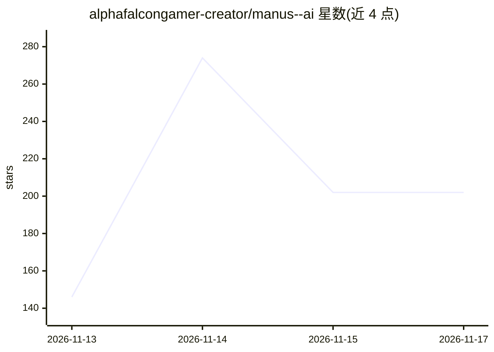

# alphafalcongamer-creator/manus--ai

⭐ 202 · Apache-2.0 · 推送 2026-11-15 · [GitHub](https://github.com/alphafalcongamer-creator/manus--ai) · 个人维护

**面向日常任务的自主 AI Agent：自动执行代码与浏览器操作**

README 以介绍性内容为主：称 Manus 为自主 AI Agent，可在用户指令下编写并执行脚本、控制浏览器完成填表、信息收集等多步骤任务，定位为家庭、学习与轻量办公场景的后台个人助手，而非企业级平台。给出兼容性表（最低 4 GB 内存、双核 CPU）与六步上手流程（准备、配置、测试等），但未提供代码仓库、安装命令、技术架构或模型接入方式等可验证细节，仅有 'Download Manus' 与促销码字样。按描述属于终端用户直接获得模型输出的应用。

## 筛选速览

| 维度 | 判定 | 备注 |
|---|---|---|
| AI 角色 | `ai-native` | 本体是模型或模型工具 |
| 许可风险 | `permissive` | Apache-2.0 |
| 部署形态 | `None` |  |
| 模型依赖 | — | README 未给出锁定关系 |
| 硬件要求 | — | 无带数字的原话,不猜 |
| 安装摩擦 | `low` | 无编译、无系统依赖或容器化 |
| 成熟度 | — | 结构信号不足 |

## 能力要点

- 自主执行代码与脚本运行
- 浏览器控制：导航、填表、信息收集
- 代码与浏览器操作可在同一任务流中衔接
- 声明跨会话记忆工作流模式

## 适用场景

- 让 agent 代为完成重复性网页操作与信息收集
- 学习中整理研究资料、运行小脚本
- 轻量办公中跨多页面汇总信息

## 场景标签

`AI 助手` `浏览器自动化` · 领域:效率与自动化

## 证据(README 行号)

> L10: - **Autonomous Code Execution:** Manus AI agent runs code on its own to complete tasks, so you can focus on decisio
> L18: Manus is an autonomous AI agent designed to run code and control a browser on your behalf. Instead of acting like a

## 星数曲线

2026-11-13 146 → 2026-11-17 202（+56）

---
*卡片 v1 · prompt 1.4 · 生成 2026-11-17 · 置信度 low · 依据 README sha `fbfd5e977bf4` · [字段定义](../../DATASET.md)*
