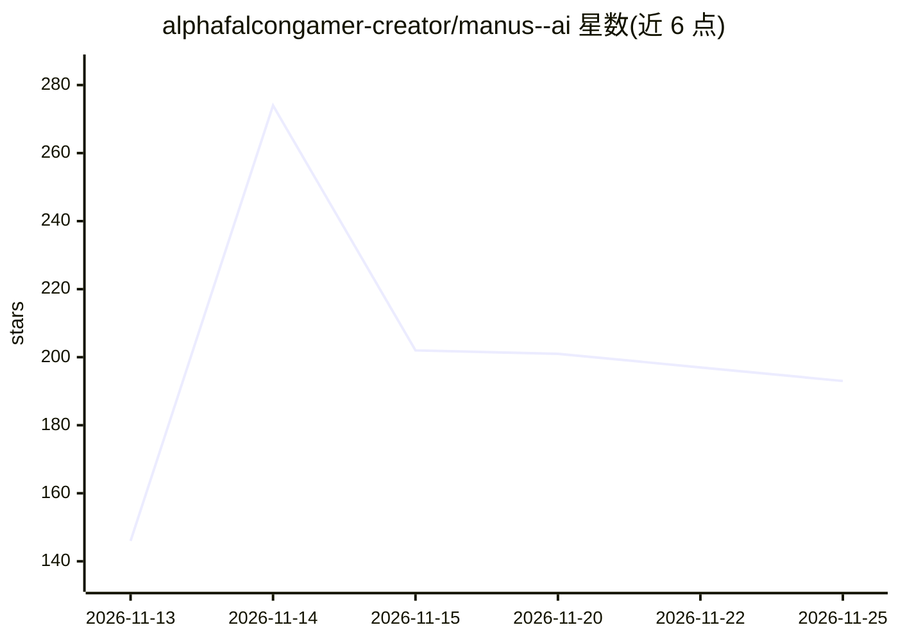

# alphafalcongamer-creator/manus--ai

⭐ 193 · Apache-2.0 · 推送 2026-11-17 · [GitHub](https://github.com/alphafalcongamer-creator/manus--ai) · 个人维护

**自主 AI 代理：代替用户执行代码与控制浏览器完成任务**

Manus 是一个自主 AI agent 项目，README 描述其可自行编写并执行脚本、控制浏览器（打开网页、填表、采集信息），并完成多步骤任务，面向家庭、学习与轻量办公场景的非开发者用户。描述称其支持沙箱环境中运行各类工具与操作，并可在会话间记住任务模式。README 未给出任何安装命令、技术架构、模型接入方式或代码入口，仅含功能描述、兼容性表格（4GB 内存起步）与使用建议，无法从文本验证其实际实现。

## 筛选速览

| 维度 | 判定 | 备注 |
|---|---|---|
| AI 角色 | `ai-native` | 本体是模型或模型工具 |
| 许可风险 | `permissive` | Apache-2.0 |
| 部署形态 | `None` |  |
| 模型依赖 | — | README 未给出锁定关系 |
| 硬件要求 | — | 无带数字的原话,不猜 |
| 安装摩擦 | `low` | 无编译、无系统依赖或容器化 |
| 成熟度 | — | 结构信号不足 |

## 能力要点

- 自主编写并执行脚本（Autonomous Code Execution）
- 浏览器控制：导航网页、填写表单、采集信息
- 代码与浏览器操作可在同一任务流中衔接
- 面向多步骤任务的低监督执行

## 适用场景

- 让学生整理研究笔记、运行小脚本
- 让代理跨多个网页采集数据并汇总
- 委托重复性的小型日常任务

## 场景标签

`浏览器自动化` `AI 助手` · 领域:效率与自动化

## 证据(README 行号)

> L10: - **Autonomous Code Execution:** Manus AI agent runs code on its own to complete tasks, so you can focus on decisio
> L11: - **Browser Control Made Simple:** Manus browser control lets the agent navigate websites, fill forms, and gather i
> L18: Manus is an autonomous AI agent designed to run code and control a browser on your behalf. Instead of acting like a

## 星数曲线

2026-11-13 146 → 2026-11-25 193（+47）

---
*卡片 v1 · prompt 1.4 · 生成 2026-11-18 · 置信度 mid · 依据 README sha `32e48e22fb91` · [字段定义](../../DATASET.md)*
