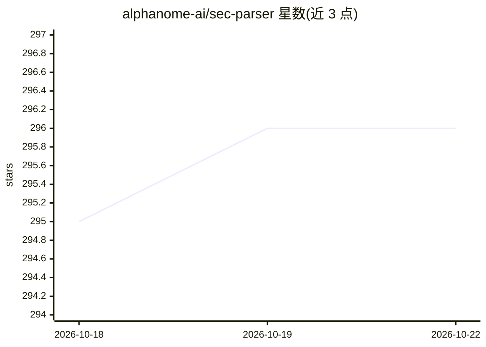

# alphanome-ai/sec-parser

⭐ 296 · Python · MIT · 推送 2026-06-25 · [GitHub](https://github.com/alphanome-ai/sec-parser) · 组织维护

**SEC EDGAR 财报 HTML 解析库：产出语义元素树**

Python 库 sec-parser，将 SEC EDGAR 的 10-Q、10-K 等 HTML 财报文档解析为语义元素列表（章节标题、段落、表格）并可构建语义树，支持按父级章节过滤。面向金融分析、合规检查、学术研究与 AI/ML/LLM 数据预处理场景。配合 sec-downloader 下载文件；README 提及可搭配 MemWalker 等 AI 技术与 ChatGPT 类 LLM 使用。注意：仓库声明不再维护（Beta）。

## 筛选速览

| 维度 | 判定 | 备注 |
|---|---|---|
| AI 角色 | `ai-ecosystem` | LLM/agent 周边工具 |
| 许可风险 | `permissive` | MIT |
| 部署形态 | `library` | 以包/库形式分发 |
| 模型依赖 | — | README 未给出锁定关系 |
| 硬件要求 | — | 无带数字的原话,不猜 |
| 安装摩擦 | `low` | 无编译、无系统依赖或容器化 |
| 成熟度 | `idea` | |

## 能力要点

- HTML 财报解析为分类的语义元素（标题/段落/表格）
- TreeBuilder 构建语义树，可按父级章节过滤
- 配合 sec-downloader 从 SEC EDGAR 程序化下载文件
- 支持 10-K、10-Q、8-K、S-1 等多种 SEC 表单类型

## 适用场景

- 从 10-Q/10-K 财报中提取特定章节的财务数据做量化建模
- 把解析后的财报文本作为 LLM 问答或情感分析的输入
- 学术研究中批量处理公开财务披露文档

## 场景标签

`文档解析` `金融量化` · 领域:知识与检索

## 证据(README 行号)

> L38:  Parse SEC EDGAR HTML documents into a tree of elements that correspond to the visual structure of the document.
> L49: This tool is especially beneficial for Artificial Intelligence (AI), Machine Learning (ML), and Large Language Mode

## 星数曲线

2026-10-18 295 → 2026-10-22 296（+1）

---
*卡片 v1 · prompt 1.4 · 生成 2026-10-21 · 置信度 mid · 依据 README sha `23030e816d1e` · [字段定义](../../DATASET.md)*
