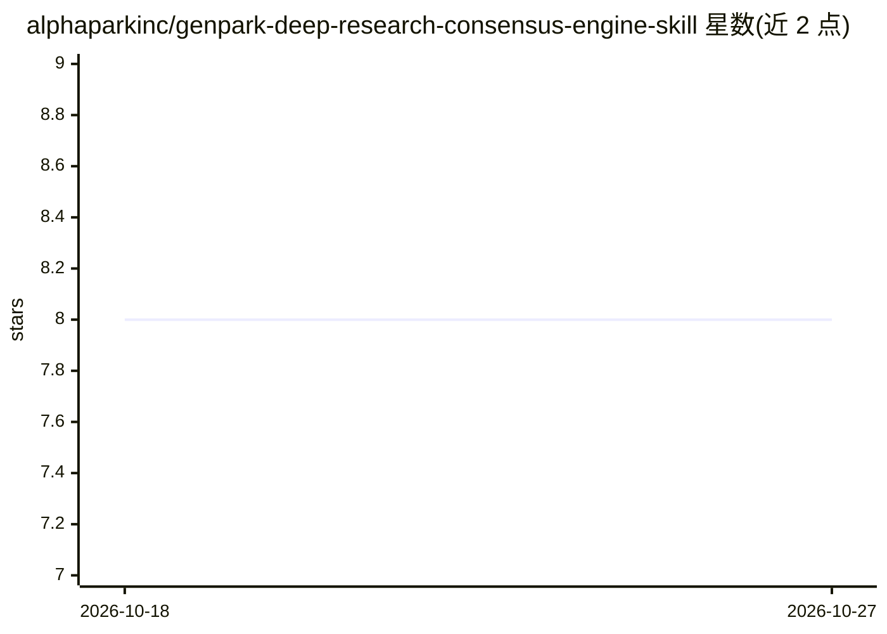

# alphaparkinc/genpark-deep-research-consensus-engine-skill

⭐ 8 · Python · 推送 2026-09-12 · [GitHub](https://github.com/alphaparkinc/genpark-deep-research-consensus-engine-skill) · [官网](https://genpark.ai/mcp) · 组织维护

**零依赖 Python 深度研究多源共识仲裁 MCP 技能**

由 GenPark AI 维护的 AI agent 技能：以纯 Python 标准库实现深度研究的多源共识仲裁引擎，对来源权威性与矛盾进行数学评分，输出结构化结果与遥测数据。提供 MCP 服务器与 CLI 两种运行形态，可接入 Claude Desktop、Cursor 等 MCP 客户端；也可直接以 Python 模块调用。零外部依赖，Python 3.9+ 即可运行，通过 JSON-RPC 与客户端交互。

## 筛选速览

| 维度 | 判定 | 备注 |
|---|---|---|
| AI 角色 | `ai-ecosystem` | LLM/agent 周边工具 |
| 许可风险 | `permissive` | — |
| 部署形态 | `None` |  |
| 模型依赖 | — | README 未给出锁定关系 |
| 硬件要求 | — | 无带数字的原话,不猜 |
| 安装摩擦 | `low` | 无编译、无系统依赖或容器化 |
| 成熟度 | — | 结构信号不足 |

## 动量与使用信号

- 安装:github 包 `release-assets` 月下载无数据

## 能力要点

- 零外部 pip 依赖，100% Python 标准库实现
- 原生 MCP 支持，可接入 Claude Desktop / Cursor / Windsurf
- 多源共识仲裁：对权威性与矛盾进行数学评分
- 提供 MCP 服务器（python mcp_server.py --test）与编程调用两种方式

## 适用场景

- 为 MCP 客户端接入深度研究共识仲裁工具
- 在 agent 工作流中做多源研究结果的一致性核验
- 以纯标准库 Python 环境运行，避免依赖冲突

## 场景标签

`科研工具` · 领域:学习与行业

## 证据(README 行号)

> L9:  Production-Grade AI Agent Skill • 100% Standard Library Python • Native Model Context Protocol (MCP)
> L21: * 🔌 **Native Model Context Protocol (MCP)**: Seamlessly plugs into Cursor IDE, Claude Desktop, and Windsurf.
> L29:     User([🌐 Developer / AI Agent]) -->|JSON-RPC Request| MCP[⚡ MCP Server / CLI]

## 星数曲线

2026-10-18 8 → 2026-10-27 8（+0）

---
*卡片 v1 · prompt 1.4 · 生成 2026-10-18 · 置信度 mid · 依据 README sha `72b5dc030cf7` · [字段定义](../../DATASET.md)*
