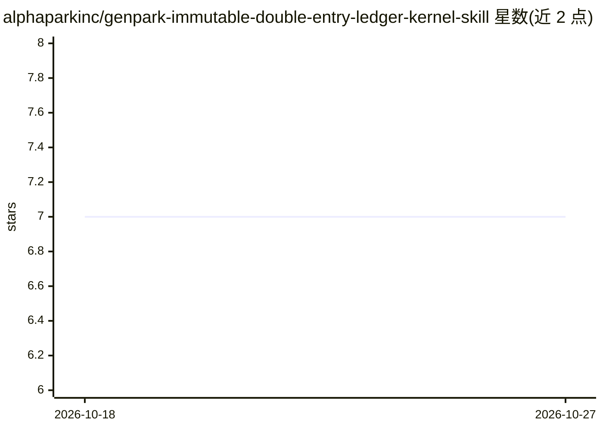

# alphaparkinc/genpark-immutable-double-entry-ledger-kernel-skill

⭐ 7 · Python · NOASSERTION · 推送 2026-09-28 · [GitHub](https://github.com/alphaparkinc/genpark-immutable-double-entry-ledger-kernel-skill) · [官网](https://genpark.ai/mcp) · 组织维护

**零依赖 Python 双式记账引擎：借 贷平衡与哈希链审计，供 MCP agent 调用**

纯标准库（hmac/hashlib）实现的加密双式记账引擎：强制 sum(Debits)==sum(Credits) 不变量、HMAC-SHA256 签名校验、哈希链审计轨迹与滑动窗口欺诈检测。以 MCP skill 形式提供，可接入 Claude Desktop、Cursor、Windsurf 等 MCP 客户端，也可直接用 Python 导入或 CLI 运行（python mcp_server.py --test 验证协议）。面向自主金融 agent、支付 webhook 与实时账务场景，要求 Python 3.9+，无外部 pip 依赖。

## 筛选速览

| 维度 | 判定 | 备注 |
|---|---|---|
| AI 角色 | `ai-ecosystem` | LLM/agent 周边工具 |
| 许可风险 | `permissive` | NOASSERTION |
| 部署形态 | `None` |  |
| 模型依赖 | — | README 未给出锁定关系 |
| 硬件要求 | — | 无带数字的原话,不猜 |
| 安装摩擦 | `low` | 无编译、无系统依赖或容器化 |
| 成熟度 | — | 结构信号不足 |

## 动量与使用信号

- 安装:github 包 `release-assets` 月下载无数据

## 能力要点

- 强制 Debits=Credits 不变量与 HMAC-SHA256 签名校验
- 哈希链审计轨迹与滑动窗口欺诈检测
- 100% Python 标准库实现，零 pip 依赖
- 原生 MCP 支持，接入 Claude Desktop/Cursor/Windsurf

## 适用场景

- 为金融 agent 提供带审计轨迹的不可变记账能力
- 校验支付 webhook 事件的账务平衡与欺诈风险
- 在 MCP 客户端中作为记账工具服务调用

## 场景标签

 · 领域:金融科技/账务核算

## 证据(README 行号)

> L9:  Production-Grade FinTech & Autonomous Financial Ledger Skill • 100% Standard Library Python • Native Model Context 
> L21: * 🔌 **Native Model Context Protocol (MCP)**: Seamlessly plugs into Cursor IDE, Claude Desktop, and Windsurf.

## 星数曲线

2026-10-18 7 → 2026-10-27 7（+0）

---
*卡片 v1 · prompt 1.4 · 生成 2026-10-18 · 置信度 high · 依据 README sha `76abead87968` · [字段定义](../../DATASET.md)*
