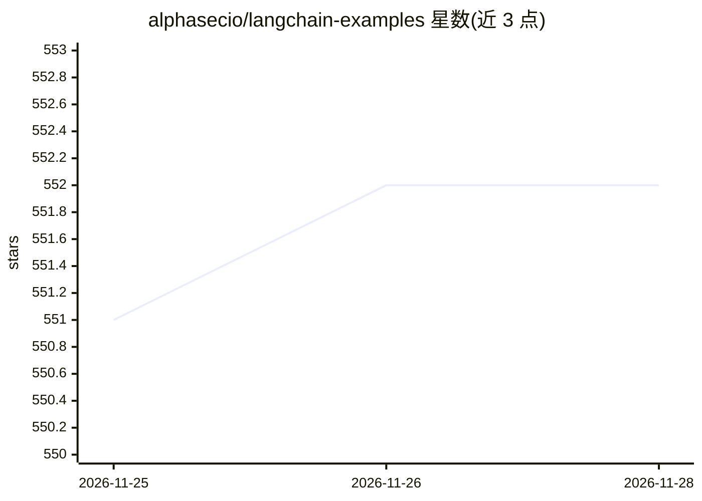

# alphasecio/langchain-examples

⭐ 552 · Python · MIT · 推送 2026-11-24 · [GitHub](https://github.com/alphasecio/langchain-examples) · [官网](https://go.alphasec.io/langchain-examples) · 个人维护

**四合一 LangChain Streamlit 示例应用：联网调研/摘要/新闻速递/文档问答**

单个 Streamlit 应用集成四个 LangChain 工具：联网搜索并带引用作答的 Web Research agent、支持文本/网页/PDF 多种摘要形态的 Summarize、按主题生成单段速递的 News Digest，以及把 PDF/文本/Markdown 存入向量库并按页引用作答的 Chat with Docs。向量库默认 Postgres+pgvector，可选 Pinecone；支持 Railway 一键模板或任意 VPS 用 Docker 部署，也可本地 pip 安装运行。需配置 OpenAI key 与至少一个搜索 API key，未设 APP_PASSWORD 时服务器端 key 有被滥用风险（README 明确警示）。

## 筛选速览

| 维度 | 判定 | 备注 |
|---|---|---|
| AI 角色 | `ai-native` | 本体是模型或模型工具 |
| 许可风险 | `permissive` | MIT |
| 部署形态 | `self-host` | docker 或自建部署 |
| 模型依赖 | — | README 未给出锁定关系 |
| 硬件要求 | — | 无带数字的原话,不猜 |
| 安装摩擦 | `low` | 无编译、无系统依赖或容器化 |
| 成熟度 | — | 结构信号不足 |

## 能力要点

- 四个工具：Web Research agent、Summarize、News Digest、Chat with Docs
- 文档问答输出页级引用，Web Research 输出来源引用
- 向量库可选 pgvector（默认）或 Pinecone，经环境变量切换
- 支持 8 个搜索 API 供应商可选（Tavily/Exa/Firecrawl/Perplexity/Serper 等）

## 适用场景

- 部署一个可联网检索并给出引用来源的问答应用
- 对粘贴文本、网页或 PDF 生成不同粒度的摘要
- 把本地 PDF/Markdown 文档入库后按页引用追问
- 按主题自动汇总新闻生成每日速递

## 场景标签

`文档问答` `AI 写作` · 领域:内容生成

## 证据(README 行号)

> L19: A single Streamlit app with four practical LangChain tools, using OpenAI models, your choice of web search provider
> L23: |🔎 **Web Research**|An agent that searches the web, reads pages and answers with cited sources.|
> L26: |📚 **Chat with Docs**|Stores PDF, text and Markdown files in a vector store (Postgres with pgvector, or Pinecone) a

## 星数曲线

2026-11-25 551 → 2026-11-28 552（+1）

---
*卡片 v1 · prompt 1.4 · 生成 2026-11-26 · 置信度 high · 依据 README sha `b5e5fa824279` · [字段定义](../../DATASET.md)*
