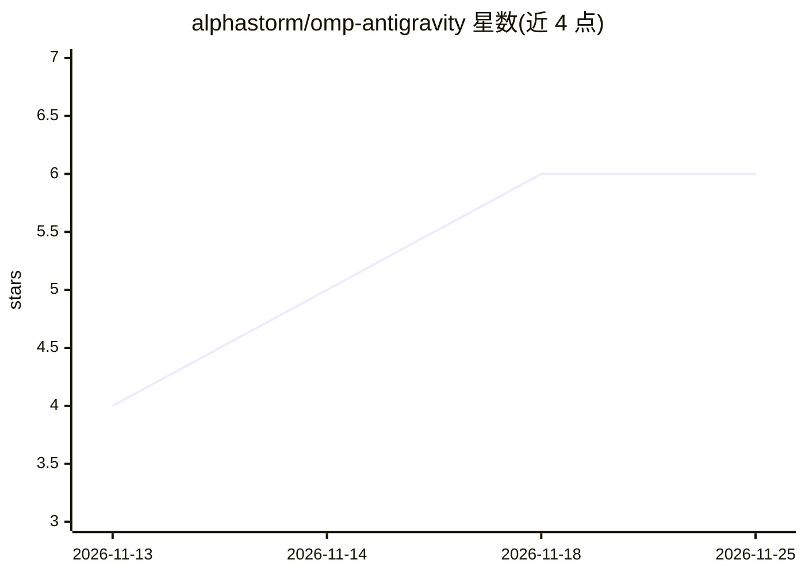

# alphastorm/omp-antigravity

⭐ 6 · TypeScript · MIT · 推送 2026-11-11 · [GitHub](https://github.com/alphastorm/omp-antigravity) · [官网](https://alphastorm.github.io/omp-antigravity/) · 个人维护

**给 Oh My Pi 接入 Google Antigravity 服务的模型的插件**

为 Oh My Pi（OMP）编码代理添加 antigravity-acp 模型提供者的插件：通过 Google 官方 agy CLI 以 ACP 协议请求 Gemini、Claude、GPT-OSS 模型，使用 Google 账号登录而非 API key。OMP 保留系统提示词、工具、审批策略与会话记录；agy 自带工具被排除，令牌不读不存。仅测试于 macOS arm64，Windows 不支持；README 提示 Google 条款可能限制第三方接入，需自行判断合规。

## 筛选速览

| 维度 | 判定 | 备注 |
|---|---|---|
| AI 角色 | `ai-ecosystem` | LLM/agent 周边工具 |
| 许可风险 | `permissive` | MIT |
| 部署形态 | `None` |  |
| 模型依赖 | — | README 未给出锁定关系 |
| 硬件要求 | — | 无带数字的原话,不猜 |
| 安装摩擦 | `low` | 无编译、无系统依赖或容器化 |
| 成熟度 | `idea` | |

## 能力要点

- 通过官方 agy CLI 与 ACP 协议接入，使用 Google 账号登录，不读 API key
- OMP 保留系统提示词、工具、审批与会话记录，agy 工具被排除在受限 profile 外
- 提供 /antigravity-doctor 检查二进制、登录、ACP 能力与模型目录
- 会话转录不一致时重建 agy 会话并重放记录

## 适用场景

- 想在 Oh My Pi 里用 Antigravity 提供的 Gemini/Claude/GPT-OSS 模型
- 内置 google-antigravity provider 不可用但装有官方 agy CLI 时的替代通道
- 希望凭 Google 官方二进制与 OS keyring 处理登录凭据

## 场景标签

`编码 Agent` · 领域:编码与开发

## 证据(README 行号)

> L7: OMP Antigravity adds the `antigravity-acp` model provider to Oh My Pi (OMP).
> L39: Who owns what. Oh My Pi, the coding agent, keeps control: its own system prompt, tools, approval policy, and sessio
> L54: - You want Antigravity-served Gemini, Claude, or GPT-OSS models in Oh My Pi, with Oh My Pi's own tools,

## 星数曲线

2026-11-13 4 → 2026-11-25 6（+2）

---
*卡片 v1 · prompt 1.4 · 生成 2026-11-20 · 置信度 high · 依据 README sha `9e6567578670` · [字段定义](../../DATASET.md)*
