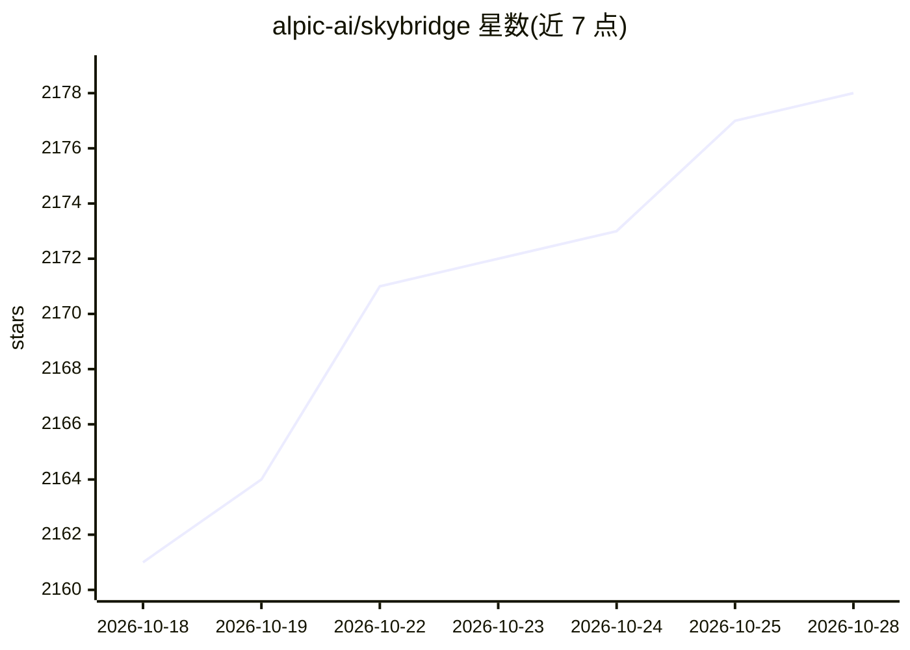

# alpic-ai/skybridge

⭐ 2,178 · TypeScript · MIT · 推送 2026-10-28 · [GitHub](https://github.com/alpic-ai/skybridge) · [官网](https://skybridge.tech) · 组织维护

**全栈 TypeScript/React 框架：构建 Claude/ChatGPT 的 MCP Apps**

面向开发者的全栈 React 框架，用于构建 MCP Apps（由 MCP 服务器渲染交互式 UI 视图的应用）与 MCP 服务器。提供带本地模拟器、热重载与永久隧道的开发服务器，抽象不同 MCP 客户端差异使应用可运行于 Claude、ChatGPT、VSCode 等客户端；实现 tRPC 式端到端类型推断与 React Query 风格 hooks。另提供面向编码 agent 的技能、CLI 与程序化 API，可通过 Alpic 平台部署或自行托管于 Node.js 环境。

## 筛选速览

| 维度 | 判定 | 备注 |
|---|---|---|
| AI 角色 | `ai-ecosystem` | LLM/agent 周边工具 |
| 许可风险 | `permissive` | MIT |
| 部署形态 | `library` | 以包/库形式分发 |
| 模型依赖 | locked-api |  |
| 硬件要求 | — | 无带数字的原话,不猜 |
| 安装摩擦 | `low` | 无编译、无系统依赖或容器化 |
| 成熟度 | — | 结构信号不足 |

## 能力要点

- 统一抽象使应用可运行于 Claude/ChatGPT/VSCode 等 MCP 客户端
- tRPC 式从工具定义到 React 视图的端到端类型安全
- 开发服务器带本地模拟器、热重载与连接本地应用到 Claude/ChatGPT 的永久隧道
- 提供面向编码 agent 的技能与 CLI/程序化开发工具 API

## 适用场景

- 为 Claude 或 ChatGPT 构建带交互式 UI 的 MCP 应用
- 让同一个 MCP 应用运行在多个 MCP 客户端上
- 用编码 agent 端到端生成和维护 MCP 应用

## 场景标签

`Agent 框架` · 领域:Agent 开发

## 证据(README 行号)

> L9:  The full-stack React framework for MCP Apps and MCP Servers.
> L22: Skybridge helps developers build type-safe MCP Apps for Claude, ChatGPT and other UI-enabled MCP clients, with a co
> L33: - **Agent-ready**: powerful skills, CLI, and programmatic dev tool APIs, everything your coding agent needs to buil

## 星数曲线

2026-10-18 2,161 → 2026-10-28 2,178（+17）

---
*卡片 v1 · prompt 1.4 · 生成 2026-10-21 · 置信度 high · 依据 README sha `4a44d1ee4cf3` · [字段定义](../../DATASET.md)*
