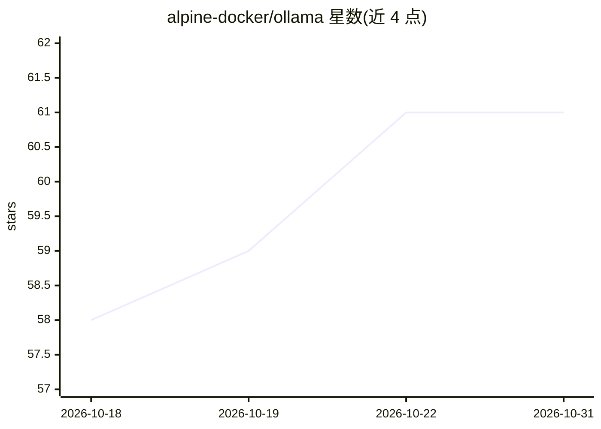

# alpine-docker/ollama

⭐ 61 · Dockerfile · MIT · 推送 2026-10-01 · [GitHub](https://github.com/alpine-docker/ollama) · [官网](https://hub.docker.com/repository/docker/alpine/ollama/general) · 个人维护

**70MB 的 CPU-only Ollama 最小化 Docker 镜像**

为无 GPU 系统提供的精简版 Ollama Docker 镜像：约 70MB，基于 wolfi.dev 而非 alpine；官方 Ollama 镜像约 4GB。通过 docker pull 与 docker run 启动 API 服务，挂载卷保存模型，用 ollama pull 下载 llama3.2 等模型后以 /api/generate 接口调用。面向在本地服务器、边缘设备、无 GPU 云环境及 Kubernetes 集群中运行本地 LLM 的开发者。README 未提供 GPU 版本说明。

## 筛选速览

| 维度 | 判定 | 备注 |
|---|---|---|
| AI 角色 | `ai-ecosystem` | LLM/agent 周边工具 |
| 许可风险 | `permissive` | MIT |
| 部署形态 | `self-host` | docker 或自建部署 |
| 模型依赖 | local-ok | 支持本地模型 |
| 硬件要求 | `cpu-ok` | |
| 安装摩擦 | `low` | 无编译、无系统依赖或容器化 |
| 成熟度 | — | 结构信号不足 |

## 能力要点

- 约 70MB 的最小化镜像，官方镜像约 4GB
- 仅支持 CPU，面向无 GPU 环境
- 暴露 11434 端口的 API 服务，可 docker exec 拉取模型
- 可部署到 Kubernetes 集群做日志分析等本地 LLM 任务

## 适用场景

- 在没有 GPU 的服务器或边缘设备上运行本地 LLM 推理
- 在资源受限环境中以小镜像部署 Ollama API 服务
- Kubernetes 集群内用本地 LLM 处理日志

## 场景标签

`推理引擎` · 领域:训练与推理

## 证据(README 行号)

> L3: This repository provides a **minimal CPU-only Ollama Docker image**, specifically designed to run on systems without
> L17: 2. **CPU-only Support**: This image is tailored for systems without GPUs. It ensures you can run Ollama efficiently

## 星数曲线

2026-10-18 58 → 2026-10-31 61（+3）

---
*卡片 v1 · prompt 1.4 · 生成 2026-10-24 · 置信度 high · 依据 README sha `6ddfd6226d25` · [字段定义](../../DATASET.md)*
