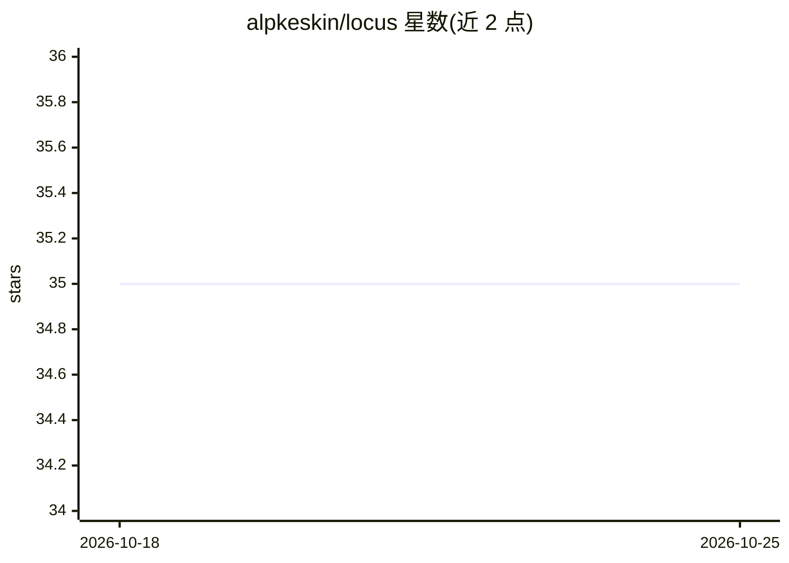

# alpkeskin/locus

⭐ 34 · Python · Apache-2.0 · 推送 2025-12-01 · [GitHub](https://github.com/alpkeskin/locus) · [官网](https://www.youtube.com/watch?v=djmkbBOoho0) · 个人维护

**从街景照片推断 GPS 坐标的开源 AI 地理定位系统**

基于 SAM3、ResNet50 与 FAISS 的图像地理定位系统，受 GeoSpy 启发。分两阶段工作：训练阶段以指定中心点和半径采样 GPS 点，经 Google Street View API 采集多方向街景，用 SAM3 分割单体建筑，ResNet50 提取 2048 维特征向量，建立带 GPS 元数据的 FAISS 向量库；搜索阶段对用户上传街景照片执行同样检测与特征提取，FAISS 检索 top-5 相似建筑、过滤低于 0.3 相似度的匹配并聚合出坐标与置信度。以源码方式提供，含 REST API（train/search 端点）。需自行获取 Google Street View API 数据构建位置库。

## 筛选速览

| 维度 | 判定 | 备注 |
|---|---|---|
| AI 角色 | `ai-native` | 本体是模型或模型工具 |
| 许可风险 | `permissive` | Apache-2.0 |
| 部署形态 | `None` |  |
| 模型依赖 | — | README 未给出锁定关系 |
| 硬件要求 | — | 无带数字的原话,不猜 |
| 安装摩擦 | `low` | 无编译、无系统依赖或容器化 |
| 成熟度 | — | 结构信号不足 |

## 能力要点

- 训练+搜索两阶段：自建街景建筑特征 FAISS 数据库后按图检索坐标
- 按单体建筑而非整景匹配（SAM3 分割 + ResNet50 特征）
- 相似度阈值 0.3 过滤与位置聚合，输出坐标及置信度
- 提供 train / search REST API

## 适用场景

- 我有一张无元数据的街景照片，想推断拍摄地点的 GPS 坐标
- 为指定区域构建可检索的建筑物特征位置库
- OSINT 场景下对街景照片做位置识别

## 场景标签

`语义搜索` · 领域:知识与检索

## 证据(README 行号)

> L5:  Turn street-level photos into GPS coordinates. No metadata required.
> L7: An open-source AI geolocation system inspired by GeoSpy. Identifies locations by detecting and matching building fea

## 星数曲线

2026-10-18 35 → 2026-10-25 35（+0）

---
*卡片 v1 · prompt 1.4 · 生成 2026-10-25 · 置信度 high · 依据 README sha `d2833647b091` · [字段定义](../../DATASET.md)*
