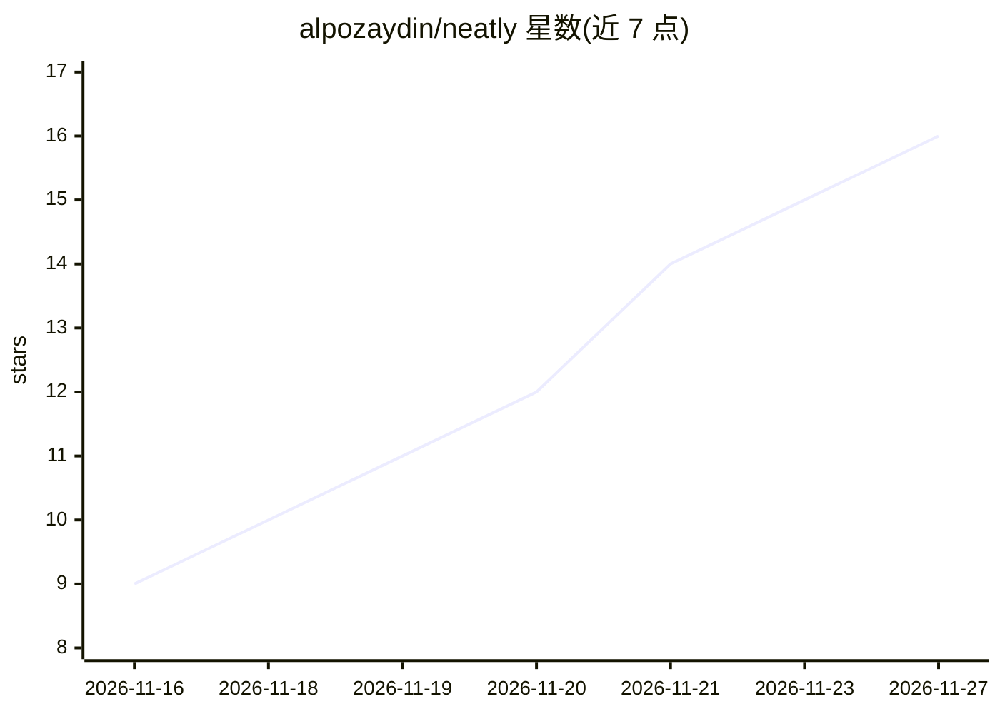

# alpozaydin/neatly

⭐ 16 · Swift · MIT · 推送 2026-11-25 · [GitHub](https://github.com/alpozaydin/neatly) · [官网](https://alpozaydin.github.io/neatly/) · 个人维护

**macOS 菜单栏 AI 文件重命名器：自动给下载/截图/照片起名并归类**

运行于 macOS 菜单栏的文件重命名工具：监控下载、为截图与照片生成可读名称并建议目标文件夹。机制上先按发票/收据等简单规则即时命名，再用 Apple 的设备端模型读取文件首页文字或图片内容生成名称，并对结果做拼写修正与虚构词过滤；支持 Finder 右键重命名、批量 Tidy、历史回滚与命名风格学习。需 Apple silicon 与 macOS 26+，几乎全部处理在设备端完成，仅论文标题查询与照片地点解析需联网。

## 筛选速览

| 维度 | 判定 | 备注 |
|---|---|---|
| AI 角色 | `ai-native` | 本体是模型或模型工具 |
| 许可风险 | `permissive` | MIT |
| 部署形态 | `None` |  |
| 模型依赖 | — | README 未给出锁定关系 |
| 硬件要求 | — | 无带数字的原话,不猜 |
| 安装摩擦 | `low` | 无编译、无系统依赖或容器化 |
| 成熟度 | — | 结构信号不足 |

## 能力要点

- 规则优先 + Apple Intelligence 设备端模型的分层命名流程
- 截图拍摄即命名，PDF/论文按标题命名并建议归档文件夹
- 仅触碰垃圾文件名，用户自选名称永不改动，每项变更可 Revert
- 菜单栏驻留、自动更新，提供 brew 与安装脚本两种安装方式

## 适用场景

- 把下载目录里杂乱的文件自动改成可读名称并归档
- 截图自动按屏幕内容命名
- 批量整理桌面/下载文件夹并逐一确认

## 场景标签

`工作流自动化` · 领域:效率与自动化

## 证据(README 行号)

> L6:  An AI file renamer for Mac: downloads, screenshots and photos get real names and the right folder.
> L73: 🔒 **Everything happens on your Mac.** neatly reads your files with Apple's on-device model. No account,

## 星数曲线

2026-11-16 9 → 2026-11-27 16（+7）

---
*卡片 v1 · prompt 1.4 · 生成 2026-11-19 · 置信度 high · 依据 README sha `078886ed6beb` · [字段定义](../../DATASET.md)*
