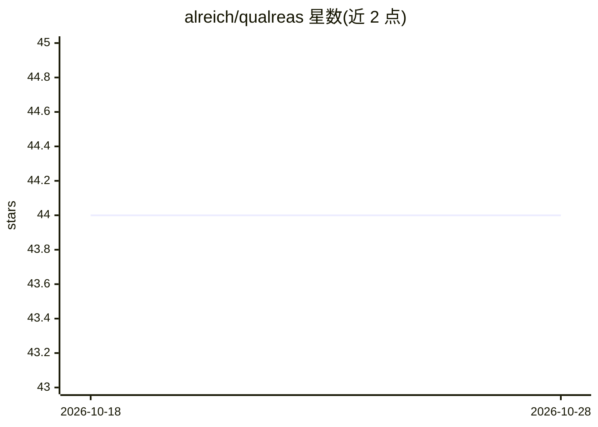

# alreich/qualreas

⭐ 44 · Jupyter Notebook · MIT · 推送 2026-10-27 · [GitHub](https://github.com/alreich/qualreas) · [官网](https://qualreas.readthedocs.io/en/latest/) · 个人维护

**时空定性推理库：用关系代数与约束网络做一致性推理**

Python 模块 qualreas 提供处理关系代数类（如 Allen 区间代数、RCC 区域连接演算及其点/分支时间扩展）的框架。以约束网络表示实体间时空约束，支持约束传播达到路径一致性、因子分解为一致的单例网络，以及查询节点/边属性；代数与网络可从 JSON 或 Python 字典读写。网络对象基于 networkx.digraph 子类，约束集合内部以 bitsets 表示。通过 pip 安装 bitsets 依赖并 git clone 源码使用，附 Jupyter notebook 示例；文档仍在 ReadTheDocs 建设中。

## 筛选速览

| 维度 | 判定 | 备注 |
|---|---|---|
| AI 角色 | `ai-native` | 本体是模型或模型工具 |
| 许可风险 | `permissive` | MIT |
| 部署形态 | `library` | 以包/库形式分发 |
| 模型依赖 | — | README 未给出锁定关系 |
| 硬件要求 | — | 无带数字的原话,不猜 |
| 安装摩擦 | `low` | 无编译、无系统依赖或容器化 |
| 成熟度 | — | 结构信号不足 |

## 能力要点

- 支持 Allen 区间代数、RCC8 及 Reich 点/分支时间扩展等关系代数
- 约束传播达成路径一致性，并可因子分解出一致单例网络
- 代数与约束网络支持 JSON / Python 字典格式读写
- Network 为 networkx.digraph 子类，约束集内部以 bitsets 表示

## 适用场景

- 表示并推理空间区域间的 RCC8 拓扑约束
- 推理时间区间与时间点之间的定性时序关系
- 用约束传播检验时空约束网络的一致性并生成单例标注

## 场景标签

 · 领域:知识表示与推理

## 证据(README 行号)

> L3: The Python module, qualreas , provides a framework for working with the class of Relation Algebras like Allen's Alge
> L5: The constraint networks in qualreas can be propagated to achieve path consistency and they can be "factored" into co

## 星数曲线

2026-10-18 44 → 2026-10-28 44（+0）

---
*卡片 v1 · prompt 1.4 · 生成 2026-10-25 · 置信度 low · 依据 README sha `6caccb7d87c7` · [字段定义](../../DATASET.md)*
