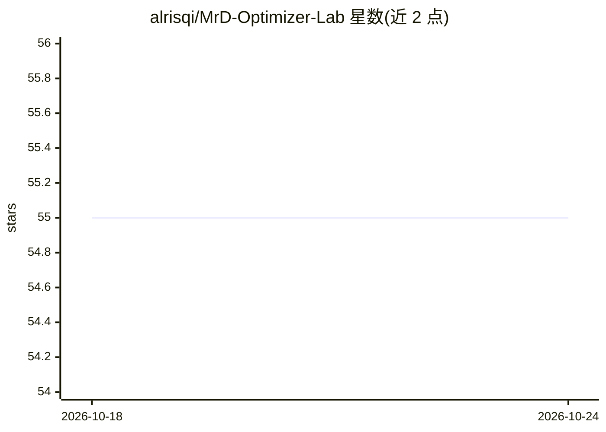

# alrisqi/MrD-Optimizer-Lab

⭐ 55 · HTML · 推送 2026-10-24 · [GitHub](https://github.com/alrisqi/MrD-Optimizer-Lab) · 个人维护

**自述为概念演示的可视化深度学习训练工作室**

README 描述了一个名为 NeuroForge Canvas 的可视化深度学习训练环境：提供拖拽式网络构建（Weave Mode）、超参自适应调优、训练过程多语言叙述生成、基于元学习器的训练曲线预测、损失曲线声音化与响应式 UI。面向 ML 研究者、MLOps 工程师、教育者等人群。安装通过自述的 aura_up 包管理器完成，依赖 Python 3.10+ 与 PyTorch/TensorFlow。注意：README 末行（L165）声明本项目为理论概念演示，不存在于生产环境，不应实际用于深度学习任务。UI 层标注使用 React/WebGL/Electron。

## 筛选速览

| 维度 | 判定 | 备注 |
|---|---|---|
| AI 角色 | `ai-ecosystem` | LLM/agent 周边工具 |
| 许可风险 | `none` | — |
| 部署形态 | `None` |  |
| 模型依赖 | — | README 未给出锁定关系 |
| 硬件要求 | — | 无带数字的原话,不猜 |
| 安装摩擦 | `medium` | 含编译或系统依赖之一 |
| 成熟度 | `idea` | |

## 能力要点

- 拖拽式神经网络构建（Weave Mode），支持分支/合并/跳连与画布上的条件逻辑
- 自调学习率与梯度健康监控（clarity index）
- 基于元学习器预测未来 50 步训练曲线的 Zeitgeist Monitor
- 训练运行自动生成 10+ 语言的可读叙述

## 适用场景

- 以可视化方式搭建与调试神经网络架构
- 长时间无监督训练时通过声音与预测面板监控状态
- 面向学生讲解训练动态

## 场景标签

`MLOps` · 领域:训练与推理

## 证据(README 行号)

> L77: ```python
> L165: *This project is a theoretical concept for demonstration purposes. It does not exist in production and should not 

## 星数曲线



2026-10-18 55 → 2026-10-24 55（+0）


---
*卡片 v1 · prompt 1.4 · 生成 2026-10-24 · 置信度 low · 依据 README sha `95f4aec31931` · [字段定义](../../DATASET.md)*
