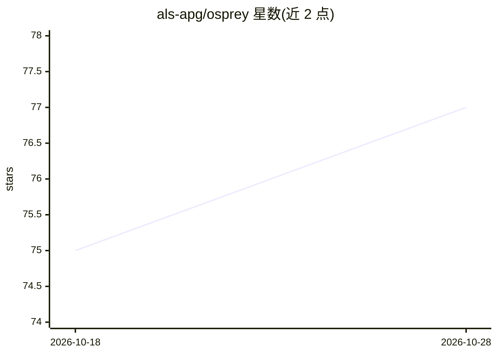

# als-apg/osprey

⭐ 78 · Python · BSD-3-Clause · 推送 2026-10-28 · [GitHub](https://github.com/als-apg/osprey) · [官网](https://als-apg.github.io/osprey/) · 组织维护

**面向科学装置控制系统的 agentic 接口与安全护栏**

为粒子加速器等大型科学设施提供 agent 与控制系统之间的接口层：通过 Skills、MCP 工具与依赖声明把操作员请求分解为可审计步骤；以语义寻址、协议无关连接器（EPICS/DOOCS/TANGO/Mock 内置）、设施电子日志搜索解决控制场景问题。安全机制包括模式检测、通道边界检查与每次硬件写入强制人工审批。以 Claude Code 为 agent harness（模型可配置），通过 uv/PyPI 安装 CLI，另有 Claude 插件市场部署路径。采用 CalVer 版本，公共 API 可能跨版本变更。

## 筛选速览

| 维度 | 判定 | 备注 |
|---|---|---|
| AI 角色 | `ai-ecosystem` | LLM/agent 周边工具 |
| 许可风险 | `permissive` | BSD-3-Clause |
| 部署形态 | `library` | 以包/库形式分发 |
| 模型依赖 | locked-api |  |
| 硬件要求 | — | 无带数字的原话,不猜 |
| 安装摩擦 | `low` | 无编译、无系统依赖或容器化 |
| 成熟度 | `idea` | |

## 能力要点

- 每次硬件写入强制人工审批，含模式检测与通道边界检查
- 内置 EPICS/DOOCS/TANGO/Mock 连接器，协议无关集成
- agent harness 为 Claude Code，模型为配置项
- 引导式 setup 生成以 profile.yml 为唯一事实源的部署仓库

## 适用场景

- 加速器/束线/探测器子系统的 agent 化操作与安全管控
- 操作员经审批门控执行设施控制任务
- 在大型科学设施中跨通道命名空间做语义寻址与日志检索

## 场景标签

 · 领域:科学计算/控制系统

## 证据(README 行号)

> L10: **An agentic interface to scientific control systems.**
> L51: - **Agent-driven orchestration** — Skills, MCP tools, and explicit dependency declarations
> L59: - **One agent, any model** — Claude Code is the agent harness, the model behind it is a

## 星数曲线

2026-10-18 75 → 2026-10-28 77（+2）

---
*卡片 v1 · prompt 1.4 · 生成 2026-10-24 · 置信度 high · 依据 README sha `d770b0b6b6cc` · [字段定义](../../DATASET.md)*
