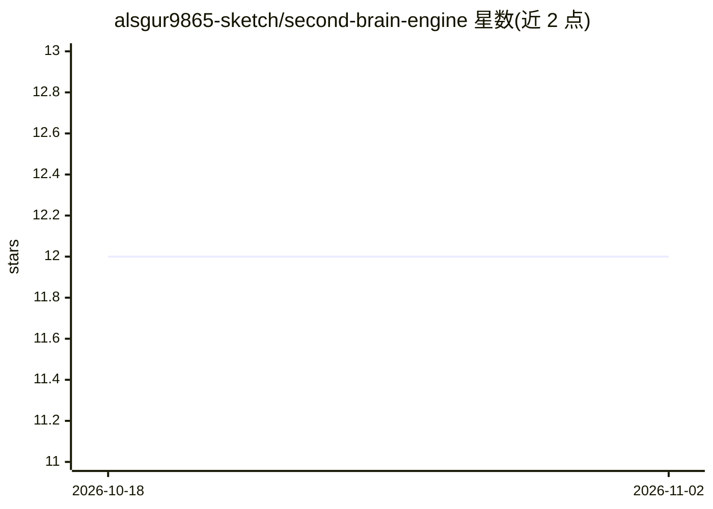

# alsgur9865-sketch/second-brain-engine

⭐ 12 · Python · MIT · 推送 2026-06-09 · [GitHub](https://github.com/alsgur9865-sketch/second-brain-engine) · 个人维护

**面向 agent 与个人的第二大脑引擎：Markdown 索引+语义搜索+图谱**

索引一个 Markdown 笔记文件夹并提供小型 HTTP API 的通用第二大脑引擎。Agent 通过 MCP（remember/recall 工具）写入工作记忆，人类在浏览器中以 Obsidian 风格图谱浏览；支持语义搜索（结果携带 wiki-link 邻居）、基于本地 LLM 的严格 RAG 问答、近重复笔记嵌入检测与合并、节点类型与关系边分类。嵌入后端可切换 7 种（默认 Ollama 的 bge-m3，可换 OpenAI/Voyage/Gemini 等），生成式 LLM 目前仅支持 Ollama。技术栈为 Python + FastAPI + Chroma。

## 筛选速览

| 维度 | 判定 | 备注 |
|---|---|---|
| AI 角色 | `ai-native` | 本体是模型或模型工具 |
| 许可风险 | `permissive` | MIT |
| 部署形态 | `self-host` | docker 或自建部署 |
| 模型依赖 | local-ok | 支持本地模型 |
| 硬件要求 | — | 无带数字的原话,不猜 |
| 安装摩擦 | `low` | 无编译、无系统依赖或容器化 |
| 成熟度 | — | 结构信号不足 |

## 能力要点

- MCP remember/recall 工具供 Claude Code 等 agent 存取工作记忆，MCP 服务自动拉起引擎
- 语义搜索返回 wiki-link 关联簇；/ask 严格模式仅从笔记作答
- 嵌入后端可单环境变量切换 7 种，按模型保留索引
- 近重复笔记检测合并与 [[links]] 自动重接；关系边（supports/refutes/expands）分类

## 适用场景

- 给 Claude Code/Cursor 等 MCP 客户端接入持久工作记忆
- 以图谱方式浏览和检索个人 Markdown 笔记库
- 对自己笔记做严格来源限定的 RAG 问答

## 场景标签

`知识库管理` `知识图谱` `RAG` `语义搜索` · 领域:知识与检索

## 证据(README 行号)

> L7: A general-purpose **second-brain engine**: an **agent writes to it (via MCP), and a
> L20: - **Ask (RAG)** — `POST /ask` searches your notes and a local LLM answers **from

## 星数曲线

2026-10-18 12 → 2026-11-02 12（+0）

---
*卡片 v1 · prompt 1.4 · 生成 2026-11-01 · 置信度 mid · 依据 README sha `9948a7506fe2` · [字段定义](../../DATASET.md)*
