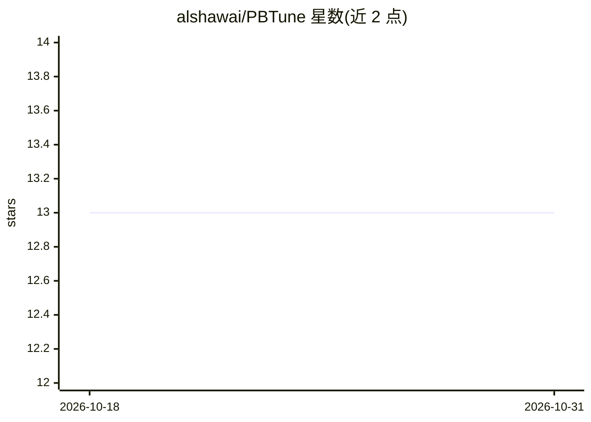

# alshawai/PBTune

⭐ 13 · Python · GPL-3.0 · 推送 2026-10-28 · [GitHub](https://github.com/alshawai/PBTune) · [官网](https://alshawai.github.io/PBTune/) · 个人维护

**面向开发者的 PostgreSQL 配置自动调优研究实现（PBT 进化算法）**

将源自 DeepMind 神经网络超参优化的 Population-Based Training 应用于 PostgreSQL 配置调优：维护一组并行 worker，各持有独立数据库实例上的配置，定期让底部 20% 复制顶部 20% 配置并做扰动，逐代收敛到高性能配置。支持 5/13/36/80+ 旋钮分层搜索、OLTP/OLAP/混合负载、Sysbench 外部基准与内部 JSON 查询模板双评测路径、特性驱动评分策略。需 Python 3.11+ 与 PostgreSQL 14+，以研究实现形式提供，产出 JSON 结果与 HTML 日志。

## 筛选速览

| 维度 | 判定 | 备注 |
|---|---|---|
| AI 角色 | `ai-ecosystem` | LLM/agent 周边工具 |
| 许可风险 | `viral` | GPL-3.0 |
| 部署形态 | `library` | 以包/库形式分发 |
| 模型依赖 | — | README 未给出锁定关系 |
| 硬件要求 | — | 无带数字的原话,不猜 |
| 安装摩擦 | `low` | 无编译、无系统依赖或容器化 |
| 成熟度 | — | 结构信号不足 |

## 能力要点

- PBT 进化策略调优 PostgreSQL 300+ 配置参数，无需预训练或外部数据集
- 4 档旋钮空间（5/13/36/80+）与 5 档调优配置档（rapid 至 extreme）
- Sysbench 外部 C 基准与内部 JSON 查询模板双评测路径
- 特性驱动评分策略 feature_driven_v2 与兼容旧会话的 fixed_v1

## 适用场景

- 自动调优 PostgreSQL 服务器配置以提升 OLTP/OLAP 负载性能
- 在不依赖 DBA 专家经验的情况下探索数据库配置空间
- 以进化优化方法做数据库调优的对比研究（含 BO 基线输出目录）

## 场景标签

 · 领域:数据库运维/自动调优

## 证据(README 行号)

> L13: This repository contains a research implementation applying **Population-Based Training (PBT)**, originally develop
> L25: Database configuration tuning is a critical yet challenging task in database administration. PostgreSQL exposes ove
> L32: This work proposes a **novel alternative**: applying Population-Based Training—an evolutionary algorithm that maint

## 星数曲线

2026-10-18 13 → 2026-10-31 13（+0）

---
*卡片 v1 · prompt 1.4 · 生成 2026-10-31 · 置信度 mid · 依据 README sha `73f65fd26152` · [字段定义](../../DATASET.md)*
