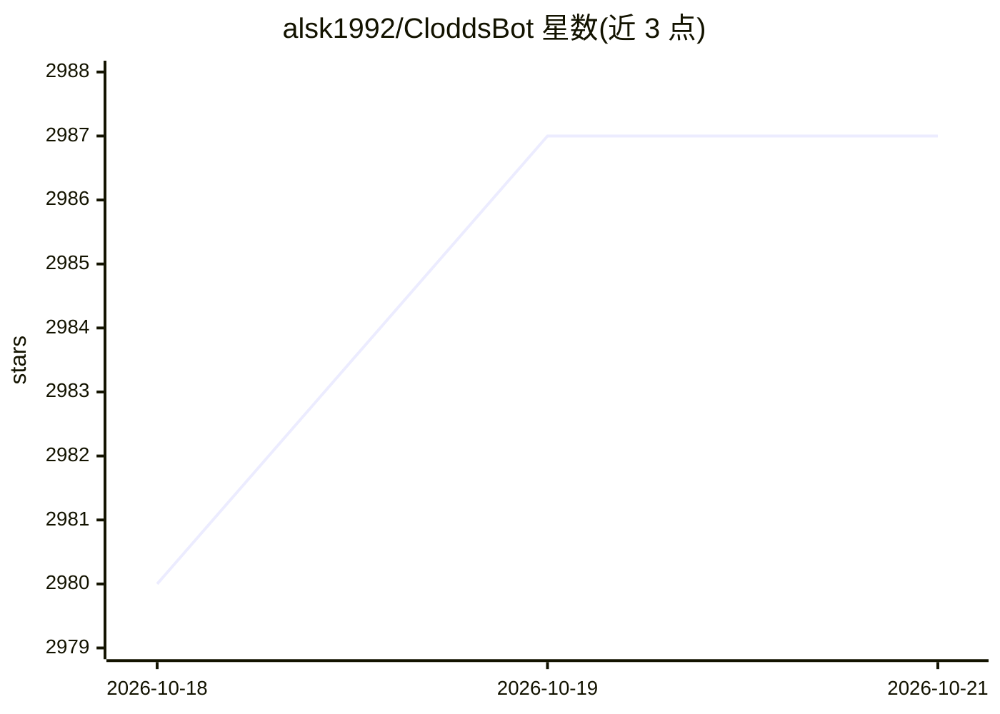

# alsk1992/CloddsBot

⭐ 2,987 · TypeScript · MIT · 推送 2026-10-02 · [GitHub](https://github.com/alsk1992/CloddsBot) · [官网](https://www.cloddsbot.com) · 个人维护

**自托管的个人 AI 交易终端：对话式操作预测市场、加密与期货**

基于 Node.js/TypeScript 的个人 AI 交易终端，由 Claude 驱动（支持 8 家 LLM 提供商），通过 21 种消息平台或内置 WebChat 用自然语言执行交易：覆盖 10 个预测市场、7 家永续期货交易所、Solana/EVM DeFi、代币发射与 Bittensor 挖矿。内置 118+ 交易策略、121 个技能、统一风控引擎（熔断、VaR、Kelly 仓位、日亏损限额）、套利检测（默认 dry-run）与回测。数据持久化用 SQLite/LanceDB/PostgreSQL。为 Colosseum 黑客松 12 天开发的作品。

## 筛选速览

| 维度 | 判定 | 备注 |
|---|---|---|
| AI 角色 | `ai-native` | 本体是模型或模型工具 |
| 许可风险 | `permissive` | MIT |
| 部署形态 | `self-host` | docker 或自建部署 |
| 模型依赖 | locked-api |  |
| 硬件要求 | — | 无带数字的原话,不猜 |
| 安装摩擦 | `low` | 无编译、无系统依赖或容器化 |
| 成熟度 | — | 结构信号不足 |

## 能力要点

- 10 个预测市场 + 7 家期货交易所 + Solana/EVM DeFi 的对话式下单
- 118+ 交易策略与统一风控引擎（熔断、VaR/CVaR、Kelly、kill switch）
- 121 个技能可经 MCP Server 暴露给 Claude Desktop/Claude Code
- 21 个消息渠道接入，内置 WebChat 含无限历史与上下文压缩

## 适用场景

- 通过 Telegram/Discord 等聊天工具管理多平台交易
- 跨平台套利扫描与预测市场轮次交易
- 运行 DCA、均值回归等自动化交易机器人并回测

## 场景标签

`金融量化` · 领域:学习与行业

## 证据(README 行号)

> L30: **Clodds** is a personal AI trading terminal for prediction markets, crypto spot, perpetual futures with leverage, 
> L32: Powered by Claude with 118+ trading strategies, whale tracking, arbitrage detection, copy trading, and DCA bots.
> L219: **8 LLM providers:** Claude (primary), GPT-4, Gemini, Groq, Together, Fireworks, AWS Bedrock, Ollama

## 星数曲线

2026-10-18 2,980 → 2026-10-21 2,987（+7）

---
*卡片 v1 · prompt 1.4 · 生成 2026-10-20 · 置信度 mid · 依据 README sha `37ec53aef6f7` · [字段定义](../../DATASET.md)*
