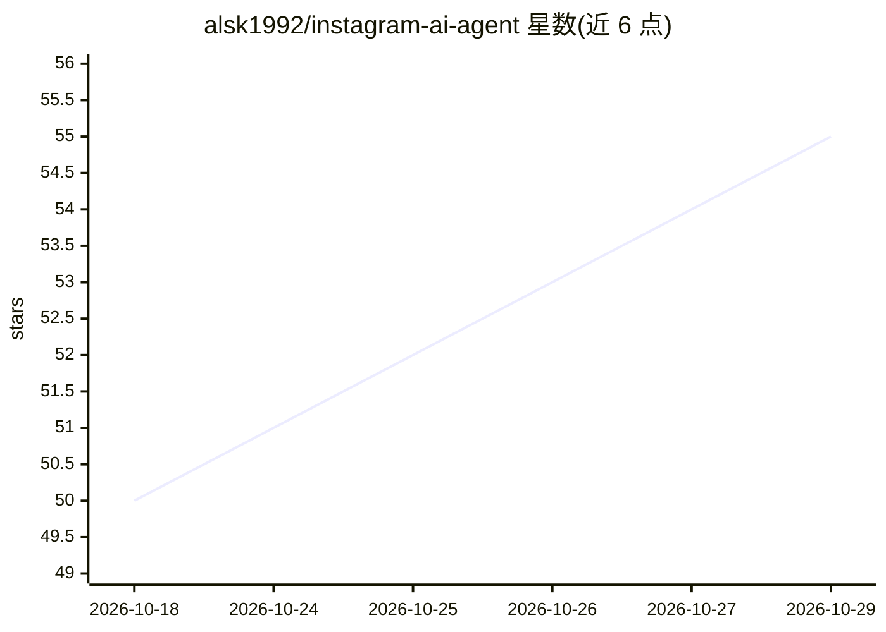

# alsk1992/instagram-ai-agent

⭐ 55 · Python · MIT · 推送 2026-04-21 · [GitHub](https://github.com/alsk1992/instagram-ai-agent) · 个人维护

**自主运营 Instagram 账号的 AI agent：生成并定时发布内容**

Python CLI 守护进程，面向想自动运营 Instagram 页面的个人用户：按设定利基自动撰写文案、生成图片/短视频（梗图、语录卡、轮播、Reels 等）、定时发布、回复评论、执行 14 天养号爬坡与频率退避。LLM 路由支持 OpenRouter/Groq/Gemini/Cerebras 免费档并自动回退；含 8 项反检测层、评论审核门（--review）、趋势挖掘与利基 RAG。需 Python 3.11+ 与 ffmpeg，可在本机或低配 VPS 部署，pipx/脚本一键安装。

## 筛选速览

| 维度 | 判定 | 备注 |
|---|---|---|
| AI 角色 | `ai-native` | 本体是模型或模型工具 |
| 许可风险 | `permissive` | MIT |
| 部署形态 | `library` | 以包/库形式分发 |
| 模型依赖 | locked-api |  |
| 硬件要求 | — | 无带数字的原话,不猜 |
| 安装摩擦 | `high` | 编译与系统依赖俱全 |
| 成熟度 | — | 结构信号不足 |

## 能力要点

- LLM 路由支持 OpenRouter/Groq/Gemini/Cerebras 免费档并自动回退
- 多种内容形式：梗图、语录卡、轮播、AI 生成 Reels、统一角色形象
- 8 项反检测层 + 14 天养号爬坡与每日操作限额
- 一键安装（pipx/install.sh），支持 --review 人工审核门

## 适用场景

- 全自动运营一个利基 Instagram 账号并定时发帖
- 首次使用时先人工审核前 20-30 条帖子再交给 agent
- 在低配 VPS 上长期无人值守运行

## 场景标签

`AI 写作` `图像生成` `工作流自动化` · 领域:效率与自动化

## 证据(README 行号)

> L3: **An AI that runs your Instagram page for you.**
> L139: - **LLM router**: OpenRouter + Groq + Gemini + Cerebras with automatic fallback

## 星数曲线

2026-10-18 50 → 2026-10-29 55（+5）

---
*卡片 v1 · prompt 1.4 · 生成 2026-10-24 · 置信度 mid · 依据 README sha `8e32ad0cf9bd` · [字段定义](../../DATASET.md)*
