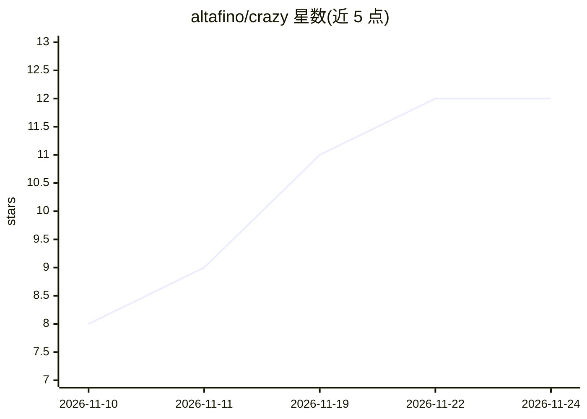

# altafino/crazy

⭐ 12 · Rust · Apache-2.0 · 推送 2026-11-22 · [GitHub](https://github.com/altafino/crazy) · [官网](https://github.com/altafino/crazy#readme) · 个人维护

**Linux 桌面工作台：描述应用，由 AI 编码代理构建并安装**

本地优先的桌面工作台（Tauri 2 + Rust + Vue 3），把描述应用、AI 代理编辑、审批命令与 diff、实时预览、Git 版本管理、构建 AppImage 并安装到 GNOME 启动器的流程整合到一个窗口。代理通过适配器接入，首个适配器为 Claude Code（stream-json 协议）。当前仅支持 Linux（Manjaro/Arch 验证，需 glibc 2.44+），版本 0.6.0，不提供云服务，项目即普通 Git 仓库。

## 筛选速览

| 维度 | 判定 | 备注 |
|---|---|---|
| AI 角色 | `ai-ecosystem` | LLM/agent 周边工具 |
| 许可风险 | `permissive` | Apache-2.0 |
| 部署形态 | `desktop` | 安装包/桌面程序 |
| 模型依赖 | locked-api |  |
| 硬件要求 | — | 无带数字的原话,不猜 |
| 安装摩擦 | `medium` | 含编译或系统依赖之一 |
| 成熟度 | `idea` | |

## 能力要点

- 每次编辑与命令以审批卡展示，未批准不执行，含 sudo/git push 等风险动作额外确认
- Changes 标签按运行查看 diff 并可逐文件回滚，运行前记录 Git 检查点
- 一步构建 AppImage、冒烟测试并安装进 GNOME 启动器，支持激活/回滚发布
- Docker 容器内导出 .AppImage/.deb/.rpm 及 Windows setup.exe

## 适用场景

- 用一段文字描述让 AI 代理生成桌面应用并安装到 Linux 桌面
- 在图形界面中审批、审查并回滚 AI 编码代理的每次改动
- 为自制应用做 Git 版本管理与 GitHub 发布

## 场景标签

`编码 Agent` · 领域:编码与开发

## 证据(README 行号)

> L3: **Describe an app. Watch an AI agent build it. Install it on your desktop.**
> L5: A local-first desktop workbench for creating, building, versioning and installing your own apps with AI coding agent
> L71: Under the hood Studio is a Tauri 2 app: a Rust backend that runs the agent, Git, builds and installs, and a Vue 3 f

## 星数曲线

2026-11-10 8 → 2026-11-24 12（+4）

---
*卡片 v1 · prompt 1.4 · 生成 2026-11-19 · 置信度 high · 依据 README sha `3ccffa8e6db8` · [字段定义](../../DATASET.md)*
