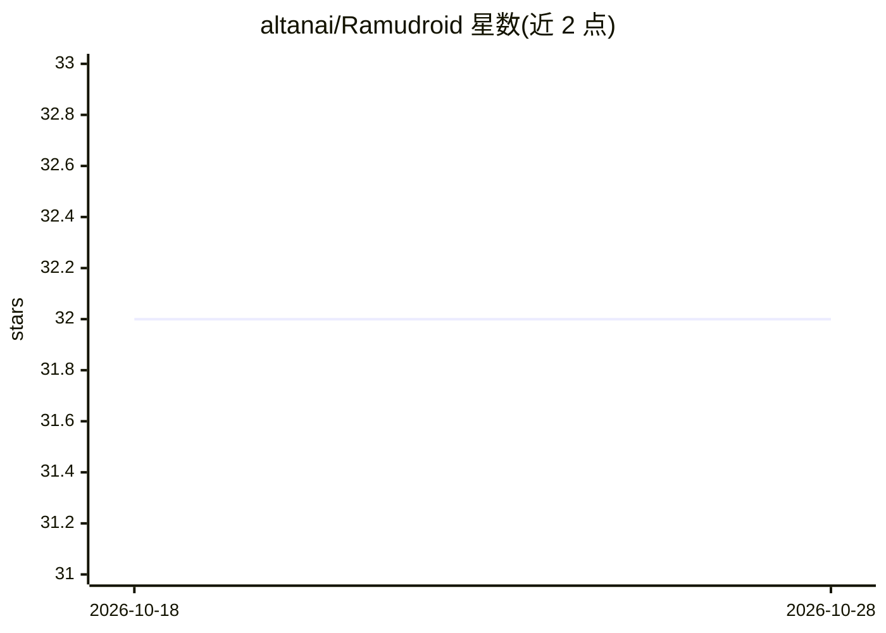

# altanai/Ramudroid

⭐ 32 · Jupyter Notebook · MIT · 推送 2026-03-31 · [GitHub](https://github.com/altanai/Ramudroid) · [官网](https://medium.com/ramudroid) · 个人维护

**自主太阳能清扫机器人：视觉检测垃圾并收集**

开源户外垃圾拾取机器人项目：Raspberry Pi 作为中央处理器运行 WebRTC 流媒体、计算机视觉检测与 Web 服务，Arduino Uno 通过串口接收指令控制电机与传感器。机器人沿道路行驶，摄像头检测垃圾后触发清扫装置（刷组、继电器、红外满载检测），支持 GPS 自主导航与远程监控控制。硬件包含 Pi NoIR 摄像头、L298 电机驱动、LiPo 电池或太阳能板供电。仓库提供各模块（导航、自驾驶训练、WebRTC 目标检测、RPi-Arduino 通信）的分区代码与设置指南。需要自行组装硬件并编译部署。

## 筛选速览

| 维度 | 判定 | 备注 |
|---|---|---|
| AI 角色 | `ai-native` | 本体是模型或模型工具 |
| 许可风险 | `permissive` | MIT |
| 部署形态 | `library` | 以包/库形式分发 |
| 模型依赖 | — | README 未给出锁定关系 |
| 硬件要求 | — | 无带数字的原话,不猜 |
| 安装摩擦 | `low` | 无编译、无系统依赖或容器化 |
| 成熟度 | — | 结构信号不足 |

## 能力要点

- 摄像头视觉检测垃圾并触发清扫作业
- Raspberry Pi + Arduino Uno 双控制器架构（串口通信）
- WebRTC 实时流媒体与 REST API 远程控制
- GPS 自主导航，v7 起太阳能供电

## 适用场景

- 搭建清扫道路与公共场所垃圾的自主机器人
- 学习 RPi+Arduino 机器人集成与视觉检测管线
- 基于 WebRTC 做机器人远程监控

## 场景标签

`目标检测` · 领域:感知与多模态

## 证据(README 行号)

> L5: RamuDroid is an open-source autonomous outdoor garbage-picking robot that combines robotics, IoT connectivity, and c
> L18: - Uses camera-based sensing to detect litter
> L19: - Triggers cleaning operation based on detection

## 星数曲线

2026-10-18 32 → 2026-10-28 32（+0）

---
*卡片 v1 · prompt 1.4 · 生成 2026-10-26 · 置信度 high · 依据 README sha `f0d15fc2188e` · [字段定义](../../DATASET.md)*
