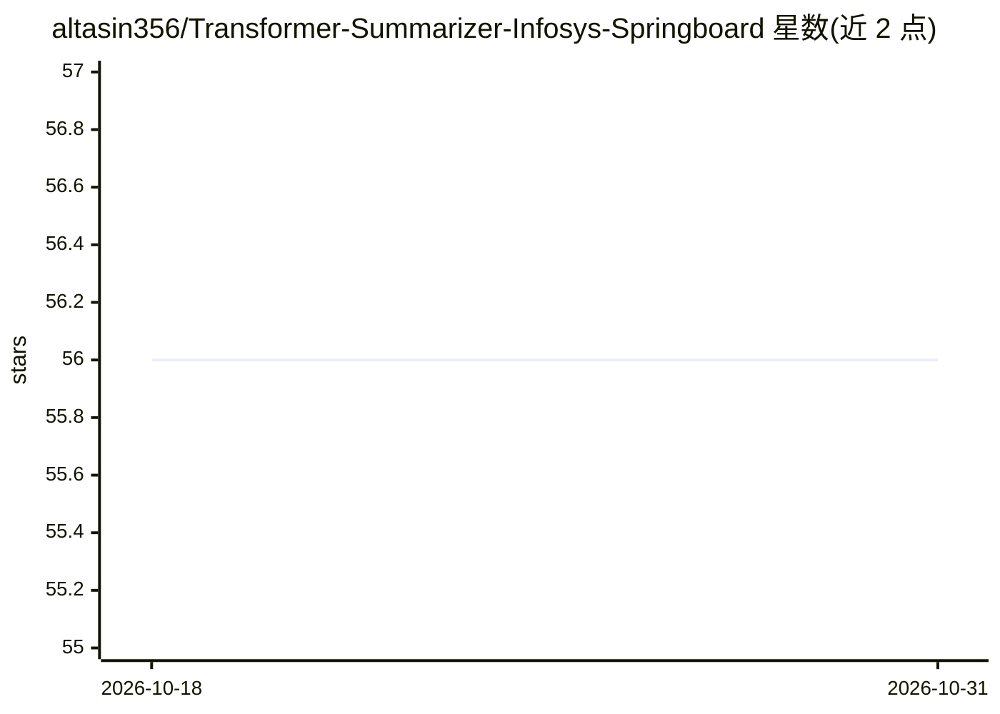

# altasin356/Transformer-Summarizer-Infosys-Springboard

⭐ 56 · HTML · 推送 2026-10-30 · [GitHub](https://github.com/altasin356/Transformer-Summarizer-Infosys-Springboard) · 个人维护

**双引擎文本摘要工具：Transformer 抽象式+规则抽取式**

LumenScribe 提供抽象式（Transformer 生成）与抽取式（规则打分选取原句）两条摘要管线，通过 strategy 参数切换，并含按文档类型与压缩率路由的 hybrid 仲裁层。支持 12+ 语言包、流式输出、移动端优先的 Web 控制台、HTTP API 与本地隐私模式；内置 ROUGE/BERTScore 等评测与实验追踪。读取纯文本/PDF/HTML，输出到控制台或 JSON。通过仓库根部的 bootstrap 脚本安装依赖与语言资源。

## 筛选速览

| 维度 | 判定 | 备注 |
|---|---|---|
| AI 角色 | `ai-native` | 本体是模型或模型工具 |
| 许可风险 | `permissive` | — |
| 部署形态 | `None` |  |
| 模型依赖 | — | README 未给出锁定关系 |
| 硬件要求 | — | 无带数字的原话,不猜 |
| 安装摩擦 | `low` | 无编译、无系统依赖或容器化 |
| 成熟度 | — | 结构信号不足 |

## 能力要点

- 抽象式与抽取式双引擎，同一 API 可切换/混合/对比
- 12+ 语言包与自动语言检测
- 内置 ROUGE、BERTScore、压缩率与忠实度评测套件
- 提供 CLI、Web 控制台与 HTTP API（/summarize、/batch 等）

## 适用场景

- 对长文档生成抽象式或抽取式摘要并对比两种结果
- 多语言文档的批量摘要处理
- 用评测套件对摘要质量做 ROUGE/BERTScore 度量

## 场景标签

`AI 写作` · 领域:内容生成

## 证据(README 行号)

> L14: > **LumenScribe** is a dual-engine summarization framework that distills long, noisy documents into crisp, faithful
> L37: - 🤖 **Dual-Engine Summarization** — Abstractive Transformer and extractive rule-based pipelines under one API.

## 星数曲线

2026-10-18 56 → 2026-10-31 56（+0）

---
*卡片 v1 · prompt 1.4 · 生成 2026-10-24 · 置信度 mid · 依据 README sha `5766e865022d` · [字段定义](../../DATASET.md)*
