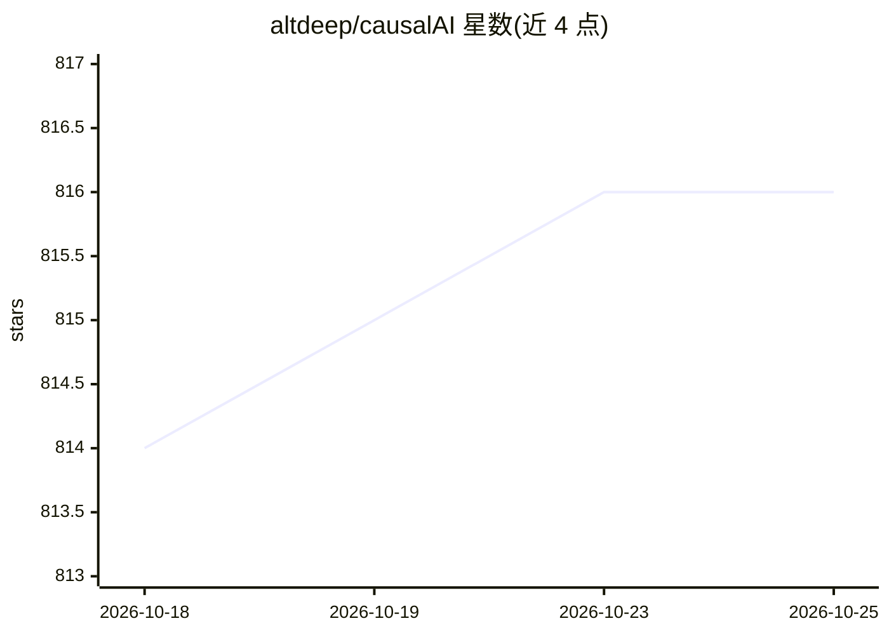

# altdeep/causalAI

⭐ 816 · Jupyter Notebook · MIT · 推送 2025-12-01 · [GitHub](https://github.com/altdeep/causalAI) · [官网](https://www.altdeep.ai/courses/causalAI) · 组织维护

**《Causal AI》书籍与研讨会的教学与代码资料库**

Altdeep.ai 维护的开源仓库，汇集《Causal AI》一书及其研讨会、研究生课程相关材料，主题涵盖基于干预的推理、因果推断算法、反事实，以及因果结构与现代机器学习系统的整合。用户可用它运行书中代码、为会议或内部培训改编研讨课、参考研究生教学大纲，或将材料用于自己的教学与研究。仓库所有材料开放且可复用于教育与研究目的。

## 筛选速览

| 维度 | 判定 | 备注 |
|---|---|---|
| AI 角色 | `ai-knowledge` | 知识聚合/清单类 |
| 许可风险 | `permissive` | MIT |
| 部署形态 | `None` |  |
| 模型依赖 | — | README 未给出锁定关系 |
| 硬件要求 | — | 无带数字的原话,不猜 |
| 安装摩擦 | `low` | 无编译、无系统依赖或容器化 |
| 成熟度 | — | 结构信号不足 |

## 能力要点

- 提供书中代码的加载与运行
- 包含研讨会与一学期研究生课程大纲
- 主题覆盖因果推断算法、反事实与因果 ML

## 适用场景

- 运行《Causal AI》书中示例代码
- 为会议或内部培训改编因果建模课程
- 参考研究生因果建模课程大纲组织教学

## 场景标签

`教程课程` · 领域:学习与行业

## 证据(README 行号)

> L1: # Causal AI Book and Workshop
> L3: This body contains materials related to the book Causal AI as well as the workshop and graduate school course based 

## 星数曲线

2026-10-18 814 → 2026-10-25 816（+2）

---
*卡片 v1 · prompt 1.4 · 生成 2026-10-21 · 置信度 high · 依据 README sha `12d00ec80885` · [字段定义](../../DATASET.md)*
