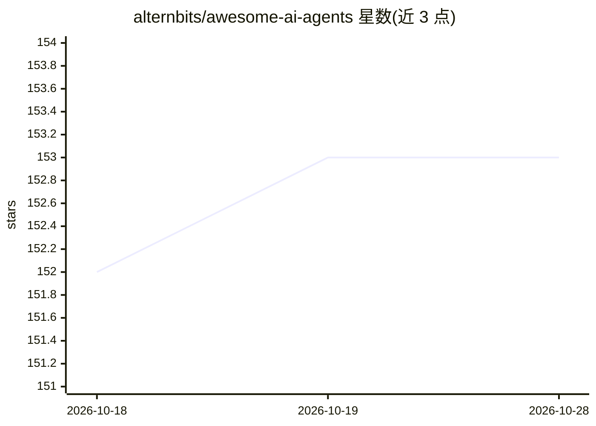

# alternbits/awesome-ai-agents

⭐ 153 · MIT · 推送 2026-02-02 · [GitHub](https://github.com/alternbits/awesome-ai-agents) · 个人维护

**AI Agent 项目策展清单：收录开源与闭源 agent 项目**

一份 AI agent 主题的 awesome list，将条目分为开源项目与闭源项目/公司两类组织。开源部分列举 Adala、AutoGen、CrewAI、AgentGPT、Aider、ChatDev、AutoGPT 等数十个项目，各附一句话描述，覆盖数据标注、多智能体框架、编码助手、开发团队模拟等方向。以 CC0 许可发布，通过 CONTRIBUTING.md 接收条目补充，并外链 agent SDK/框架相关清单。

## 筛选速览

| 维度 | 判定 | 备注 |
|---|---|---|
| AI 角色 | `ai-knowledge` | 知识聚合/清单类 |
| 许可风险 | `permissive` | MIT |
| 部署形态 | `None` |  |
| 模型依赖 | — | README 未给出锁定关系 |
| 硬件要求 | — | 无带数字的原话,不猜 |
| 安装摩擦 | `low` | 无编译、无系统依赖或容器化 |
| 成熟度 | — | 结构信号不足 |

## 能力要点

- 按开源项目与闭源项目/公司两类组织条目
- 收录数十个开源 AI agent 项目并附一句话描述
- 以 CC0 许可发布，提供贡献指南

## 适用场景

- 查找可用的开源 AI agent 项目或框架
- 了解 AI agent 生态的项目覆盖范围
- 为自研 agent 项目寻找参考实现

## 场景标签

`精选清单` · 领域:学习与行业

## 证据(README 行号)

> L1: # Awesome AI Agents
> L5: A curated list of AI agents, categorized into open-source projects and closed-source projects/companies.

## 星数曲线

2026-10-18 152 → 2026-10-28 153（+1）

---
*卡片 v1 · prompt 1.4 · 生成 2026-10-22 · 置信度 high · 依据 README sha `0d505247cb2d` · [字段定义](../../DATASET.md)*
