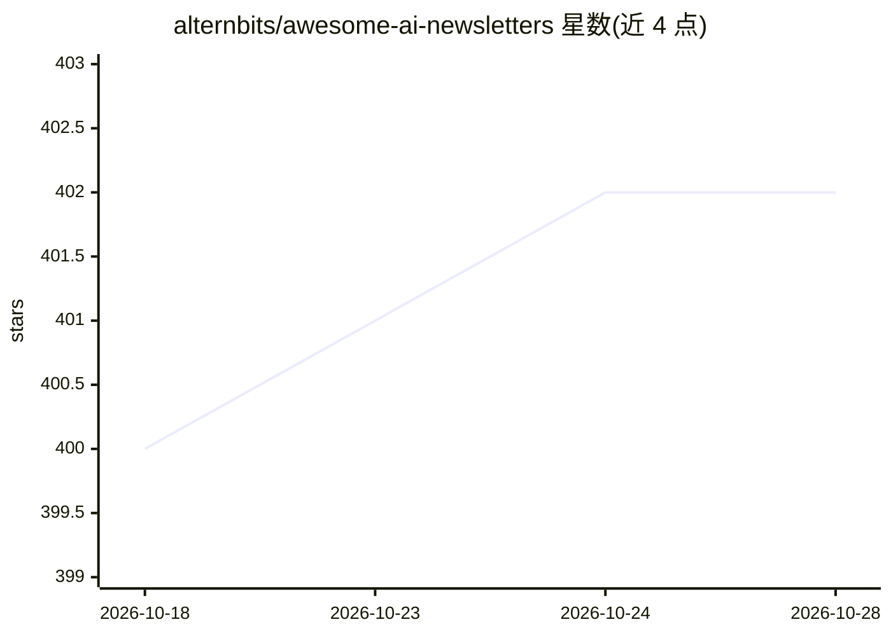

# alternbits/awesome-ai-newsletters

⭐ 402 · CC0-1.0 · 推送 2026-07-04 · [GitHub](https://github.com/alternbits/awesome-ai-newsletters) · 个人维护

**AI 相关邮件通讯（Newsletter）策展清单**

一个 awesome 风格的策展清单，收录 AI 主题邮件通讯，按 General、AI Tools、Marketing、Prompts、AI Jobs、For Professionals、Policy & Post-AI Society 等分类组织，条目附简短描述，另设 Related Lists 指向其他清单。内容覆盖 AI 新闻、AI 工具、LLM 研究论文解读、机器学习工程、AI 评测研究等方向的通讯。README 不含安装或使用说明，属于浏览型资源列表。

## 筛选速览

| 维度 | 判定 | 备注 |
|---|---|---|
| AI 角色 | `ai-knowledge` | 知识聚合/清单类 |
| 许可风险 | `viral` | CC0-1.0 |
| 部署形态 | `None` |  |
| 模型依赖 | — | README 未给出锁定关系 |
| 硬件要求 | — | 无带数字的原话,不猜 |
| 安装摩擦 | `low` | 无编译、无系统依赖或容器化 |
| 成熟度 | — | 结构信号不足 |

## 能力要点

- 按主题分类组织 AI Newsletter 条目并附简短描述
- 覆盖 AI 新闻、工具、LLM 研究、ML 工程、AI 政策等方向
- 附 Related Lists 指向其他策展清单

## 适用场景

- 按主题查找想订阅的 AI 资讯通讯
- 了解 LLM 研究与 ML 工程方向的通讯资源
- 为营销或求职目的寻找 AI 相关通讯

## 场景标签

`精选清单` · 领域:学习与行业

## 证据(README 行号)

> L1: Awesome AI Newsletters
> L3: A curated list of top best AI Related Newsletters and ai agents newsletters.

## 星数曲线

2026-10-18 400 → 2026-10-28 402（+2）

---
*卡片 v1 · prompt 1.4 · 生成 2026-10-21 · 置信度 high · 依据 README sha `7d9fd6f0bea3` · [字段定义](../../DATASET.md)*
