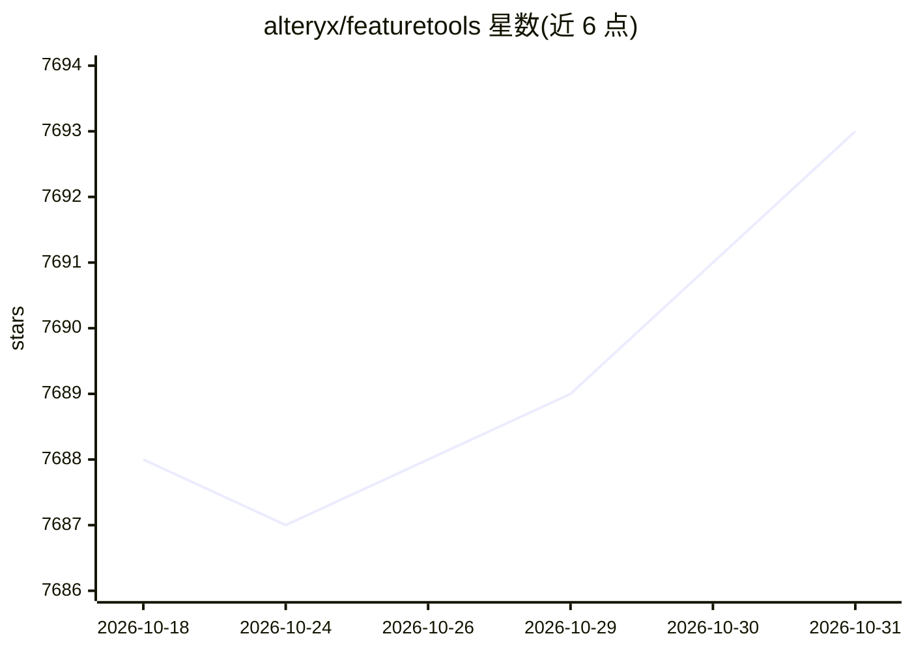

# alteryx/featuretools

⭐ 7,693 · Python · BSD-3-Clause · 推送 2026-09-11 · [GitHub](https://github.com/alteryx/featuretools) · [官网](https://www.featuretools.com) · 组织维护

**面向数据科学家的 Python 自动特征工程库**

Alteryx 维护的 Python 库，通过 Deep Feature Synthesis（DFS）算法从多表关系型数据集自动生成特征矩阵，内置多种特征原语并支持自定义原语，输出可直接用于机器学习的特征向量。提供 pip/conda 安装，附带 NLP、Premium 等可选插件包，并支持 Dask 以 njobs>1 并行运行 DFS。面向构建机器学习流水线的数据科学与开发人员，附引用论文（IEEE DSAA 2015）。

## 筛选速览

| 维度 | 判定 | 备注 |
|---|---|---|
| AI 角色 | `ai-native` | 本体是模型或模型工具 |
| 许可风险 | `permissive` | BSD-3-Clause |
| 部署形态 | `library` | 以包/库形式分发 |
| 模型依赖 | — | README 未给出锁定关系 |
| 硬件要求 | — | 无带数字的原话,不猜 |
| 安装摩擦 | `low` | 无编译、无系统依赖或容器化 |
| 成熟度 | — | 结构信号不足 |

## 能力要点

- Deep Feature Synthesis 从多表数据自动生成特征矩阵
- 内置多类特征原语并支持自定义原语
- 可选插件包：NLP Primitives、Premium Primitives、Dask 并行支持
- 提供 Instacart 300 万订单的下一购买预测演示

## 适用场景

- 我在多表交易数据上做机器学习前需要自动生成特征
- 我想复用同一套自动特征工程流水线解决多个预测问题
- 需要用 Dask 把特征工程扩展到大规模数据集

## 场景标签

`MLOps` · 领域:训练与推理

## 证据(README 行号)

> L29: Featuretools is a python library for automated feature engineering. See the documentation for more information.
> L79: Featuretools can automatically create a single table of features for any "target dataframe"

## 星数曲线

2026-10-18 7,688 → 2026-10-31 7,693（+5）

---
*卡片 v1 · prompt 1.4 · 生成 2026-10-20 · 置信度 high · 依据 README sha `a9ec3551a3c6` · [字段定义](../../DATASET.md)*
