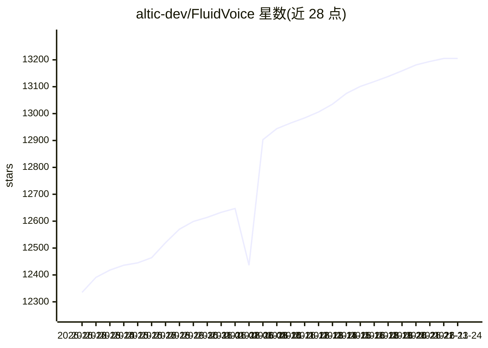

# altic-dev/FluidVoice

⭐ 13,218 · Swift · GPL-3.0 · 推送 2026-11-23 · [GitHub](https://github.com/altic-dev/FluidVoice) · [官网](https://altic.dev/fluid) · 组织维护

**macOS 本地语音听写应用：录音转文字并本地清理润色**

开源（GPLv3）的 macOS 听写应用，核验于 macOS 15+。流程分两步：Fluid Speech 模型本地将音频转为文字，Fluid Intelligence 模型可选地在本地清理文本（去填充词、格式化、按应用套用风格）；也可接入用户自备的云端 AI 提供商。附带 FluidMeet 会议转录（说话人标签、摘要、导出）、Command Mode 语音控制 Mac、Edit Mode 原地改写、全局热键与自定义词典。注意：Fluid Intelligence 运行时为私有维护，不在本仓库源码构建内；GitHub 仓库仅含 macOS 应用。

## 筛选速览

| 维度 | 判定 | 备注 |
|---|---|---|
| AI 角色 | `ai-native` | 本体是模型或模型工具 |
| 许可风险 | `viral` | GPL-3.0 |
| 部署形态 | `None` |  |
| 模型依赖 | — | README 未给出锁定关系 |
| 硬件要求 | — | 无带数字的原话,不猜 |
| 安装摩擦 | `medium` | 含编译或系统依赖之一 |
| 成熟度 | — | 结构信号不足 |

## 动量与使用信号

- 下载:GitHub Release 附件 累计 354,796(60 个 release)

## 能力要点

- Fluid Speech Pro/Mini/Pico 本地语音识别模型（25 种语言，Apple Silicon）
- Fluid 1.1 Ripple/Splash 本地文本清理模型，无需云账号或 API key
- 多种可选语音模型：Parakeet、Qwen3 ASR、Cohere Transcribe、Whisper（含 Intel 支持）等
- FluidMeet 本地会议转录、说话人标签与多格式导出

## 适用场景

- 在任何应用里用语音输入并自动清理成规范文字
- 线下/线上会议本地转录、生成摘要并回放编辑
- 不用键盘、用语音命令操作 Mac（启动应用、快捷指令）

## 场景标签

`语音识别` · 领域:感知与多模态

## 证据(README 行号)

> L12: **Free, private dictation that runs on your device.** Speak into the apps you already use, clean up your words loca
> L63: Two separate steps, both available locally:
> L83: The macOS app is open source under GPLv3. **Fluid Intelligence is a separate, privately maintained local AI runtime

## 星数曲线

2026-10-22 12,335 → 2026-11-24 13,205（+870）

---
*卡片 v1 · prompt 1.4 · 生成 2026-11-22 · 置信度 high · 依据 README sha `b35d06064460` · [字段定义](../../DATASET.md)*
