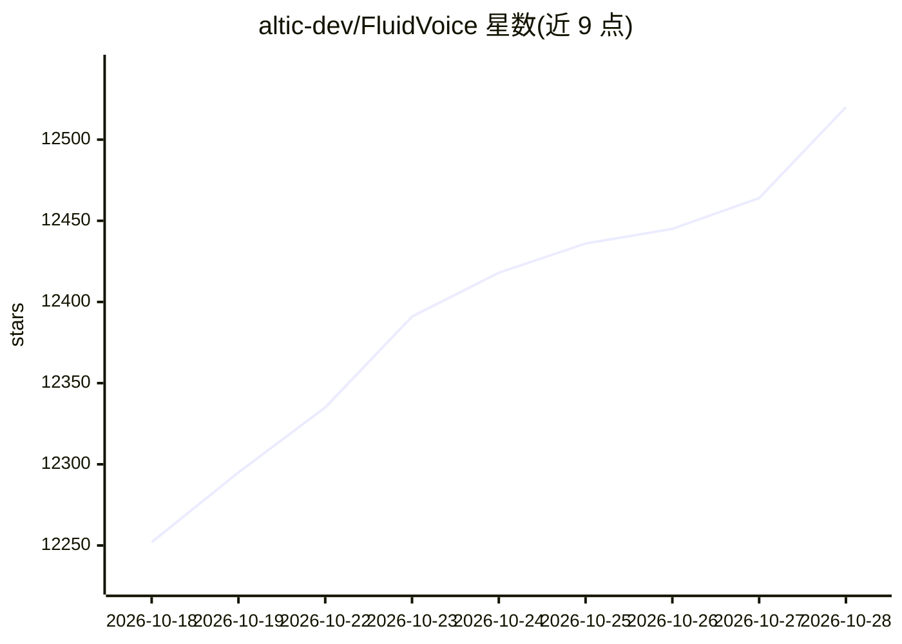

# altic-dev/FluidVoice

⭐ 12,520 · Swift · GPL-3.0 · 推送 2026-10-27 · [GitHub](https://github.com/altic-dev/FluidVoice) · [官网](https://altic.dev/fluid) · 组织维护

**macOS 开源语音听写应用：本地语音转文字与本地 AI 增强**

面向 macOS 用户的语音听写（voice-to-text）应用，Swift 编写，通过全局热键触发语音输入，将转录文本直接插入任意应用的文本框。支持多种语音模型：Nemotron Speech、Parakeet 系列、Cohere Transcribe、Apple Speech 与 Whisper（部分模型兼容 Intel Mac）。提供 Command Mode 语音控制 Mac、Write Mode 改写文本、实时转录预览等功能。AI 增强可选本地 Fluid Intelligence 模型（闭源私有运行时）或 OpenAI/Groq 等云端提供商，默认本地优先、数据不出机。

## 筛选速览

| 维度 | 判定 | 备注 |
|---|---|---|
| AI 角色 | `ai-native` | 本体是模型或模型工具 |
| 许可风险 | `viral` | GPL-3.0 |
| 部署形态 | `None` |  |
| 模型依赖 | locked-api |  |
| 硬件要求 | — | 无带数字的原话,不猜 |
| 安装摩擦 | `medium` | 含编译或系统依赖之一 |
| 成熟度 | — | 结构信号不足 |

## 动量与使用信号

- 下载:GitHub Release 附件 累计 354,796(60 个 release)

## 能力要点

- 8 种语音模型可选，Apple Speech 零下载、Whisper 兼容 Intel Mac
- 本地 AI 增强（Fluid Intelligence）：智能格式化、上下文大小写与后处理，数据不离开设备
- Command Mode 语音控制 Mac；Write Mode 在任意应用内听写或改写文本
- 可选接入 OpenAI/Groq/自定义云端 AI 增强，密钥存于 macOS Keychain

## 适用场景

- 在任意应用中用语音听写并直接插入文本
- 用语音启动应用、运行快捷指令与自动化工作流
- 选择本地模型与本地 AI 增强，保证语音数据不离开设备

## 场景标签

`语音识别` `GUI 自动化` · 领域:效率与自动化

## 证据(README 行号)

> L11: Open source voice-to-text dictation app for macOS with on-device AI enhancement.
> L39: - **Fluid Intelligence** — fully local AI model for on-device dictation enhancement. No cloud, no API keys, no data
> L84: - **Fluid Intelligence** — on-device AI enhancement for smart formatting, context-aware capitalization, and post-pr

## 星数曲线

2026-10-18 12,252 → 2026-10-28 12,520（+268）

---
*卡片 v1 · prompt 1.4 · 生成 2026-10-18 · 置信度 high · 依据 README sha `e4be70947a49` · [字段定义](../../DATASET.md)*
