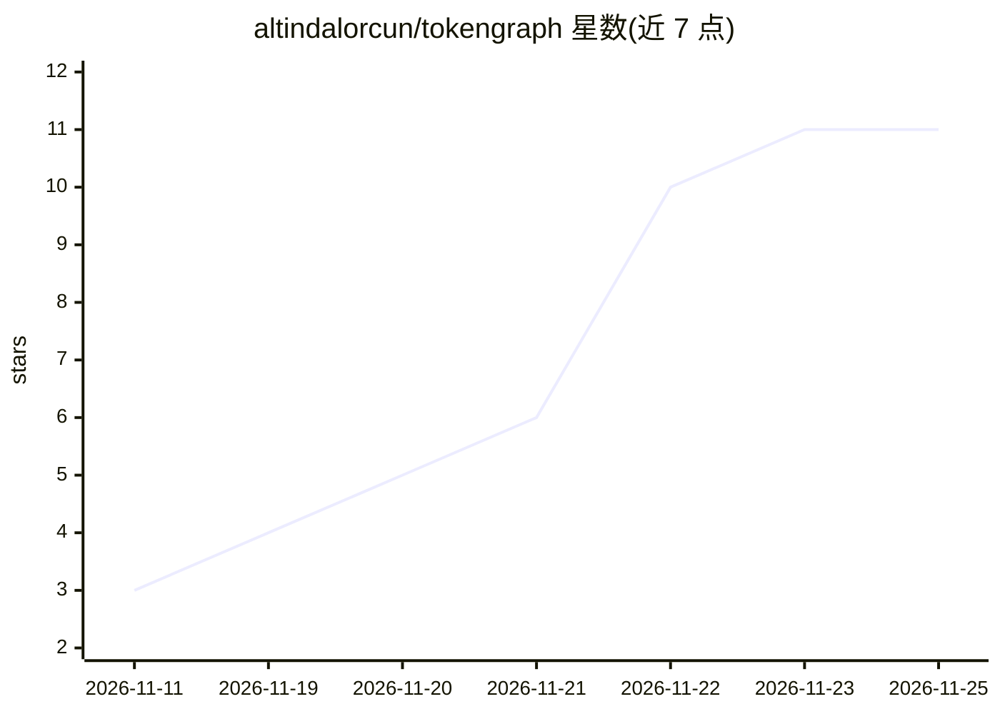

# altindalorcun/tokengraph

⭐ 11 · TypeScript · MIT · 推送 2026-11-20 · [GitHub](https://github.com/altindalorcun/tokengraph) · [官网](https://tokengraph.app) · 个人维护

**把 AI 编码 agent 的 token 用量生成 GitHub 风格贡献图**

本地优先的 CLI 工具：读取 Claude Code、Codex CLI、Cursor、Gemini CLI 等 11 个 AI 编码 agent 已写入磁盘的用量计数，去重后按加权公式（cache reads 计 0.1）汇总到本地 ledger，渲染为按模型家族着色的年度热力图。可通过 login 发布到自己的 GitHub gist 并嵌入个人 README，支持定时同步、安装 agent 结束钩子、生成分享用 story 卡片。不读取提示词与回答，无自有服务器。需 Node.js 22+，经 npm 分发。

## 筛选速览

| 维度 | 判定 | 备注 |
|---|---|---|
| AI 角色 | `ai-ecosystem` | LLM/agent 周边工具 |
| 许可风险 | `permissive` | MIT |
| 部署形态 | `library` | 以包/库形式分发 |
| 模型依赖 | — | README 未给出锁定关系 |
| 硬件要求 | — | 无带数字的原话,不猜 |
| 安装摩擦 | `low` | 无编译、无系统依赖或容器化 |
| 成熟度 | — | 结构信号不足 |

## 能力要点

- 支持 11 个 AI 编码 agent 的本地日志读取，含桌面应用与 VS Code 系编辑器
- 按消息/响应 id 去重与加权 token 计算（cache reads ×0.1）
- 发布到自有 GitHub gist，提供 README 嵌入 SVG（明暗主题自适应）
- 支持 per-agent 结束钩子（install-hook）与小时级定时同步（schedule）

## 适用场景

- 在 GitHub 个人主页 README 展示 AI 编码 token 用量热力图
- 统计各 AI agent 每日/每项目的 token 消耗与估算成本
- 生成可分享到 Instagram/TikTok 的用量 story 卡片

## 场景标签

 · 领域:开发者工具/用量监控

## 证据(README 行号)

> L3:  Your AI coding, as a GitHub-style graph.
> L74: tokengraph reads the usage counters the agents already write to disk. It never reads your prompts
> L106: ## Supported agents

## 星数曲线

2026-11-11 3 → 2026-11-25 11（+8）

---
*卡片 v1 · prompt 1.4 · 生成 2026-11-21 · 置信度 high · 依据 README sha `8fd3a816a222` · [字段定义](../../DATASET.md)*
