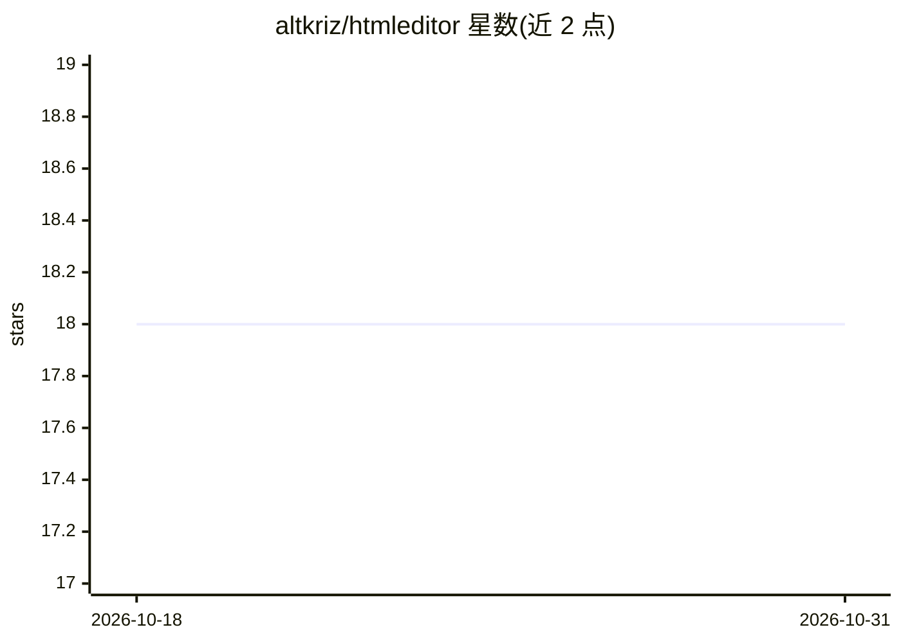

# altkriz/htmleditor

⭐ 18 · HTML · GPL-3.0 · 推送 2026-09-21 · [GitHub](https://github.com/altkriz/htmleditor) · [官网](https://altkriz.github.io/htmleditor) · 个人维护

**面向网页开发学习者的在线 HTML/CSS/JS 编辑器，内置 AI 网站生成助手**

基于浏览器的网页编码环境，提供 HTML/CSS/JS 三个 Monaco 编辑器（多标签、语法高亮、自动补全）、沙箱化实时预览（隔离 iframe、热重载）、localStorage 本地项目保存与独立 HTML 导出。集成的 KrizVibe AI 助手经 Groq API 生成完整网站代码，自动注入对应编辑器，并可读取现有代码进行迭代；设有每 IP 每分钟 6 次的请求限制与 1 万字符输入上限。打开 index.html 即可运行，可部署到 GitHub Pages 等静态托管。

## 筛选速览

| 维度 | 判定 | 备注 |
|---|---|---|
| AI 角色 | `ai-enhanced` | 去掉 AI 部分产品仍成立 |
| 许可风险 | `viral` | GPL-3.0 |
| 部署形态 | `None` |  |
| 模型依赖 | locked-api |  |
| 硬件要求 | — | 无带数字的原话,不猜 |
| 安装摩擦 | `low` | 无编译、无系统依赖或容器化 |
| 成熟度 | — | 结构信号不足 |

## 能力要点

- AI 生成代码并按 [HTML]/[CSS]/[JS] 块自动注入 Monaco 编辑器
- 三标签 Monaco 编辑器（VS Code 同款引擎）
- 沙箱 iframe 预览与防抖热重载
- localStorage 本地保存项目，可导出独立 .html 文件

## 适用场景

- 在浏览器中快速搭建和试验网页原型
- 让 AI 生成完整网站后手动修改调整
- 学习 HTML/CSS/JS 并即时看到预览效果

## 场景标签

`代码生成` · 领域:编码与开发

## 证据(README 行号)

> L5: KrizVibe Editor is a next-generation **web-based coding playground and IDE** built for creators, learners, and devel
> L7: Powered by **KrizVibe AI** — our integrated AI web-generation assistant — the editor merges traditional hand-coding 
> L13: ### 🧠 KrizVibe AI (Star Feature)

## 星数曲线

2026-10-18 18 → 2026-10-31 18（+0）

---
*卡片 v1 · prompt 1.4 · 生成 2026-10-29 · 置信度 high · 依据 README sha `30fddeaf9a99` · [字段定义](../../DATASET.md)*
