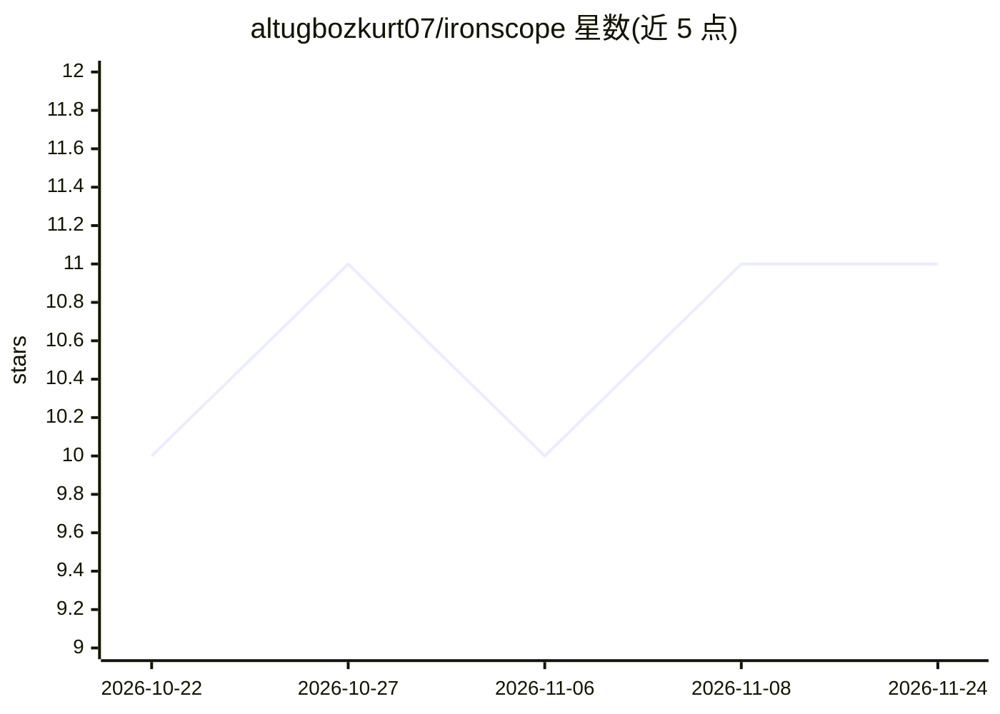

# altugbozkurt07/ironscope

⭐ 11 · Rust · Apache-2.0 · 推送 2026-06-23 · [GitHub](https://github.com/altugbozkurt07/ironscope) · 个人维护

**用 eBPF 追踪并管控 LLM agent 工具的系统调用行为**

面向 Linux 上运行的 LangChain/LangGraph 式 agent 工具，IronScope 在运行时通过 eBPF/LSM 钩子观测文件打开、exec、socket connect 等内核级行为，并将其归属到触发它的具体工具调用，输出结构化 JSON 审计事件；支持 monitor 模式审计与 enforce 模式按工具阻断文件/进程/网络操作。工具身份从 CPython 运行时状态解析，需匹配已验证的 CPython 契约（V0.1 仅验证 3.12.3 aarch64），要求 BPF LSM 内核与 root 权限。

## 筛选速览

| 维度 | 判定 | 备注 |
|---|---|---|
| AI 角色 | `ai-ecosystem` | LLM/agent 周边工具 |
| 许可风险 | `permissive` | Apache-2.0 |
| 部署形态 | `self-host` | docker 或自建部署 |
| 模型依赖 | — | README 未给出锁定关系 |
| 硬件要求 | — | 无带数字的原话,不猜 |
| 安装摩擦 | `low` | 无编译、无系统依赖或容器化 |
| 成熟度 | `idea` | |

## 能力要点

- eBPF/LSM 在内核边界观测文件、exec、socket 行为并归属到具体工具
- monitor 审计与 enforce 按工具策略阻断双模式
- 工具身份从 CPython 运行时解析，无需应用层注册
- 未知工具与解析失败有独立的 allow/deny 策略字段，fail-closed 设计

## 适用场景

- 审计 agent 工具实际读写和执行了哪些本地文件与子进程
- 按工具设置文件/进程/网络的允许或阻断策略
- 排查异步、线程池、子进程场景下行为归属不清的问题

## 场景标签

`网络安全` · 领域:学习与行业

## 证据(README 行号)

> L12: IronScope watches supported Python tool execution at runtime and connects local
> L24: The core use case is giving agentic applications a runtime safety layer around
> L29: In the current V0.1 scope, IronScope targets LangChain/LangGraph-style tools

## 星数曲线

2026-10-22 10 → 2026-11-24 11（+1）

---
*卡片 v1 · prompt 1.4 · 生成 2026-11-19 · 置信度 high · 依据 README sha `87b54eb8c35a` · [字段定义](../../DATASET.md)*
