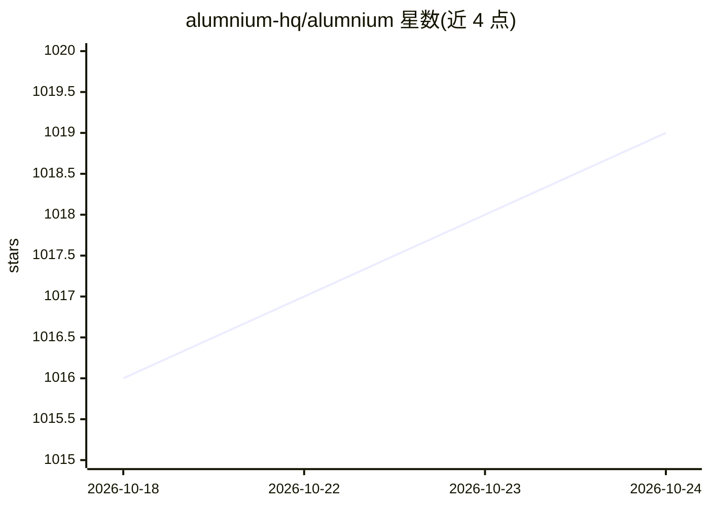

# alumnium-hq/alumnium

⭐ 1,019 · TypeScript · MIT · 推送 2026-10-23 · [GitHub](https://github.com/alumnium-hq/alumnium) · [官网](https://alumnium.ai) · 组织维护

**AI 原生的端到端测试库与 MCP，用于简化应用测试**

面向测试工程师与 AI agent 使用者的端到端测试库，同时以 MCP 服务器形式提供。它在既有测试自动化生态（Appium、Maestro、Playwright、Selenium）之上构建，提供与被测应用交互和验证断言的机制，需要 OPENAI_API_KEY 等 LLM 配置。以 Java（Gradle）、Python（pip）、TypeScript（npm）三种语言的库形式分发，另提供 curl 安装脚本接入 Claude 等 agent 的 MCP 通道。

## 筛选速览

| 维度 | 判定 | 备注 |
|---|---|---|
| AI 角色 | `ai-ecosystem` | LLM/agent 周边工具 |
| 许可风险 | `permissive` | MIT |
| 部署形态 | `library` | 以包/库形式分发 |
| 模型依赖 | — | README 未给出锁定关系 |
| 硬件要求 | — | 无带数字的原话,不猜 |
| 安装摩擦 | `low` | 无编译、无系统依赖或容器化 |
| 成熟度 | — | 结构信号不足 |

## 能力要点

- 兼容 Appium / Maestro / Playwright / Selenium 四种测试自动化框架
- 同时以库（Java/Python/TypeScript）与 MCP 服务器两种形式提供
- 提供 curl 安装脚本并支持 claude mcp add 接入 agent

## 适用场景

- 在现有 Selenium/Playwright 测试中引入 AI 驱动的交互与断言
- 让 Claude Code 等 agent 通过 MCP 直接执行端到端测试
- 跨 Java/Python/TypeScript 技术栈统一编写 AI 测试脚本

## 场景标签

`浏览器自动化` `GUI 自动化` · 领域:效率与自动化

## 证据(README 行号)

> L13: Alumnium is an AI-native library and MCP for end-to-end testing. It builds upon the existing test automation ecosys
> L28: claude mcp add alumnium --env OPENAI_API_KEY=... -- alumnium mcp

## 星数曲线

2026-10-18 1,016 → 2026-10-24 1,019（+3）

---
*卡片 v1 · prompt 1.4 · 生成 2026-10-21 · 置信度 high · 依据 README sha `8ad69640088f` · [字段定义](../../DATASET.md)*
