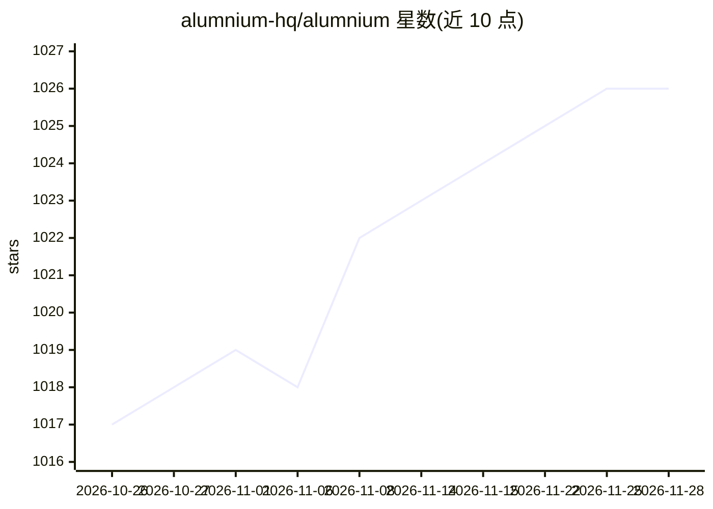

# alumnium-hq/alumnium

⭐ 1,026 · TypeScript · MIT · 推送 2026-11-25 · [GitHub](https://github.com/alumnium-hq/alumnium) · [官网](https://alumnium.ai) · 组织维护

**给开发者用的 AI 端到端测试库与 MCP 服务器**

Alumnium 是面向端到端测试的 AI-native 库，同时提供 MCP 服务器形态。它构建在既有测试自动化生态之上，与 Appium、Maestro、Playwright、Selenium 配合工作，简化与应用的交互并提供断言验证机制。提供 Java、Python、TypeScript 三种语言的 SDK，可通过安装脚本注册为 agent 的 MCP 工具，配置后由 Claude Code 等 agent 驱动执行测试。README 未给出定价或许可证细节。

## 筛选速览

| 维度 | 判定 | 备注 |
|---|---|---|
| AI 角色 | `ai-ecosystem` | LLM/agent 周边工具 |
| 许可风险 | `permissive` | MIT |
| 部署形态 | `library` | 以包/库形式分发 |
| 模型依赖 | — | README 未给出锁定关系 |
| 硬件要求 | — | 无带数字的原话,不猜 |
| 安装摩擦 | `low` | 无编译、无系统依赖或容器化 |
| 成熟度 | — | 结构信号不足 |

## 能力要点

- 同时提供库（Java/Python/TypeScript）与 MCP 服务器两种使用形态
- 配合 Appium、Maestro、Playwright、Selenium 工作
- 可通过 curl 安装脚本注册到 Claude Code 等 MCP 客户端

## 适用场景

- 在现有 Selenium/Playwright 测试项目中接入 AI 驱动的交互与断言
- 把端到端测试能力作为 MCP 工具挂到 Claude Code 上
- 用 Java/Python/TypeScript 编写 AI 辅助的端到端测试

## 场景标签

`浏览器自动化` · 领域:效率与自动化

## 证据(README 行号)

> L13: Alumnium is an AI-native library and MCP for end-to-end testing. It builds upon the existing test automation ecosys
> L28: claude mcp add alumnium --env OPENAI_API_KEY=... -- alumnium mcp

## 星数曲线

2026-10-26 1,017 → 2026-11-28 1,026（+9）

---
*卡片 v1 · prompt 1.4 · 生成 2026-11-24 · 置信度 high · 依据 README sha `d708db053d37` · [字段定义](../../DATASET.md)*
