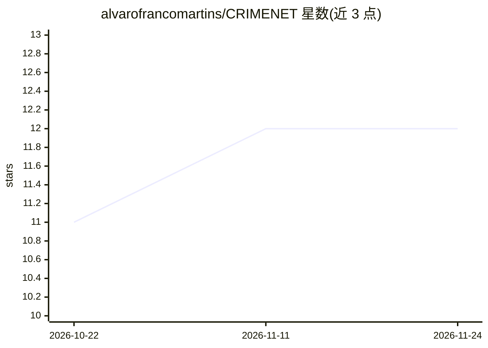

# alvarofrancomartins/CRIMENET

⭐ 12 · Python · MIT · 推送 2026-09-18 · [GitHub](https://github.com/alvarofrancomartins/CRIMENET) · [官网](https://alvarofrancomartins.com/crimenet/) · 个人维护

**用 LLM 从维基百科抽取的全球犯罪组织知识图谱数据集**

从四种语言的 1,418 篇维基百科文章中用 LLM 管道抽取犯罪组织及其关系，构建包含 4,504 个组织节点、10,935 条关系边的知识图谱。每条边附有原文证据句、释义描述、时间段和版本化来源 URL，可回溯审计。配套静态站点支持浏览器内浏览、3D 图谱、连接查找器，以及自然语言查询图谱拓扑的 Ask CRIMENET AI 接口。范围仅限组织、不含个人，网络犯罪组织暂不在内。

## 筛选速览

| 维度 | 判定 | 备注 |
|---|---|---|
| AI 角色 | `ai-knowledge` | 知识聚合/清单类 |
| 许可风险 | `permissive` | MIT |
| 部署形态 | `library` | 以包/库形式分发 |
| 模型依赖 | — | README 未给出锁定关系 |
| 硬件要求 | — | 无带数字的原话,不猜 |
| 安装摩擦 | `low` | 无编译、无系统依赖或容器化 |
| 成熟度 | — | 结构信号不足 |

## 能力要点

- 4,504 组织 / 10,935 关系，边附逐字证据句与版本化来源 URL
- 三类型对称边分类（cooperation/conflict 等），含时间 period 属性
- Ask CRIMENET AI 自然语言查询接口，回答引用维基来源
- 纯静态站点架构，无后端无数据库

## 适用场景

- 查询两个犯罪组织之间的盟友或冲突关系及证据出处
- 分析全球犯罪组织网络的中心性与社区结构
- 按国家浏览犯罪组织的地域足迹
- 基于来源 URL 审计任何一条关系声明

## 场景标签

`知识图谱` `RAG` · 领域:知识与检索

## 证据(README 行号)

> L3: Open-source knowledge graph of relationships between criminal organizations worldwide, extracted from multi-language
> L13: The current build holds **4,504 organizations** and **10,935 relationships** (1,032 organizations are profiled from

## 星数曲线

2026-10-22 11 → 2026-11-24 12（+1）

---
*卡片 v1 · prompt 1.4 · 生成 2026-11-18 · 置信度 high · 依据 README sha `249a1ca01e8b` · [字段定义](../../DATASET.md)*
