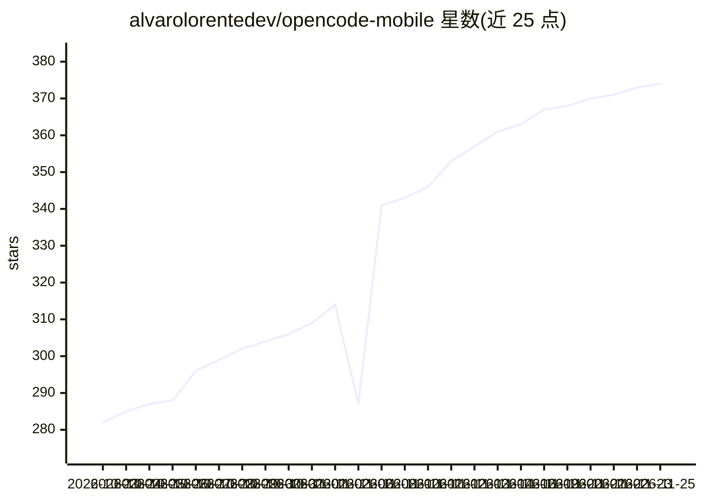

# alvarolorentedev/opencode-mobile

⭐ 374 · TypeScript · Apache-2.0 · 推送 2026-11-23 · [GitHub](https://github.com/alvarolorentedev/opencode-mobile) · [官网](https://getopencode.app/) · 个人维护

**移动端 OpenCode 客户端：随时随地管理 agent 会话**

面向 OpenCode 用户的非官方社区移动客户端，连接用户自建的 OpenCode 服务器，提供启动任务、查看进度、审批权限请求、审查 diff、打开终端、语音对话及管理多服务器/项目/会话等控制面。代码留在用户主机上，App 通过 HTTPS 隧道/VPN 远程连接服务器，无需托管服务。提供 Google Play、APK 与 iOS TestFlight 安装渠道，使用 React Native/Expo/TypeScript 构建。

## 筛选速览

| 维度 | 判定 | 备注 |
|---|---|---|
| AI 角色 | `ai-ecosystem` | LLM/agent 周边工具 |
| 许可风险 | `permissive` | Apache-2.0 |
| 部署形态 | `None` |  |
| 模型依赖 | — | README 未给出锁定关系 |
| 硬件要求 | — | 无带数字的原话,不猜 |
| 安装摩擦 | `low` | 无编译、无系统依赖或容器化 |
| 成熟度 | — | 结构信号不足 |

## 能力要点

- 从手机选择项目、worktree、agent 与模型并发送/fork/revert 提示
- 实时显示 reasoning、工具调用、shell 输出、补丁与 todos，并推送通知
- 支持口述提示、朗读回复与免提交互模式
- 支持多个服务器、项目、会话及主题/语言/小组件设置

## 适用场景

- 离开电脑时通过手机继续或审批 OpenCode agent 会话
- 远程检查服务器上的 agent 进度与文件变更
- 通过语音与 agent 进行免提对话

## 场景标签

`编码 Agent` · 领域:编码与开发

## 证据(README 行号)

> L25: It connects to the OpenCode server you already run and gives you a focused mobile control surface for the moments w
> L41: - **Run sessions from your phone** — pick a project, worktree, agent, and model, then send, fork, or revert prompts
> L151: - `@opencode/client` for native OpenCode 2; `@opencode-ai/sdk` isolated to OpenCode 1 compatibility

## 星数曲线

2026-10-23 282 → 2026-11-25 374（+92）

---
*卡片 v1 · prompt 1.4 · 生成 2026-11-25 · 置信度 high · 依据 README sha `2bf97729574b` · [字段定义](../../DATASET.md)*
