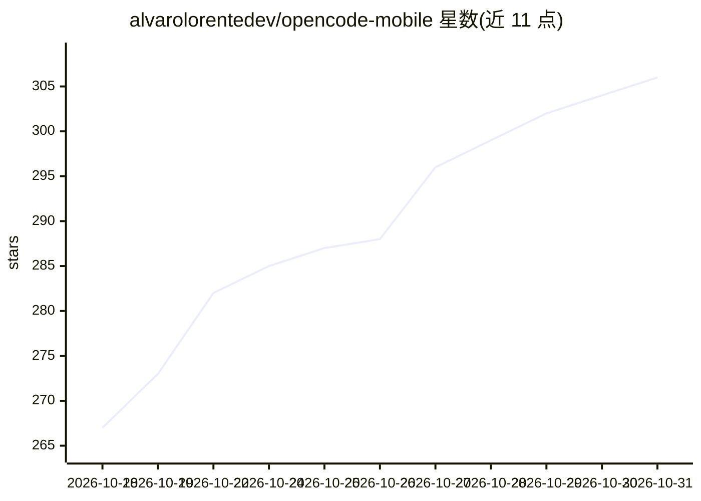

# alvarolorentedev/opencode-mobile

⭐ 306 · TypeScript · Apache-2.0 · 推送 2026-10-30 · [GitHub](https://github.com/alvarolorentedev/opencode-mobile) · [官网](https://getopencode.app/) · 个人维护

**OpenCode 服务器的移动端客户端，远程管理 AI 编码会话**

社区独立开发的移动应用（React Native/Expo/TypeScript），连接用户自托管的 OpenCode 服务器，提供手机端的控制界面：启动与继续编码会话、查看 agent 进度、审批权限请求、切换多服务器/工作区/模型、运行终端命令、浏览与修改文件、语音输入，以及查看 token 用量与预估成本。代码保留在 OpenCode 所在机器上，通过 HTTPS 隧道/VPN/反向代理远程接入。Android 经 Google Play 或 APK 分发，iOS 经 TestFlight。

## 筛选速览

| 维度 | 判定 | 备注 |
|---|---|---|
| AI 角色 | `ai-ecosystem` | LLM/agent 周边工具 |
| 许可风险 | `permissive` | Apache-2.0 |
| 部署形态 | `None` |  |
| 模型依赖 | — | README 未给出锁定关系 |
| 硬件要求 | — | 无带数字的原话,不猜 |
| 安装摩擦 | `low` | 无编译、无系统依赖或容器化 |
| 成熟度 | — | 结构信号不足 |

## 能力要点

- 远程连接自托管 OpenCode 服务器，管理多服务器/工作区/会话/模型
- 审批 agent 权限请求并在手机上审查变更
- 内置终端命令执行与文件浏览/修改
- 语音输入与 token/成本用量查看

## 适用场景

- 离开电脑时用手机跟进并审批 OpenCode agent 的编码任务
- 在移动端切换多个 OpenCode 项目与模型继续会话
- 远程运行少量终端命令而不必重新打开笔记本

## 场景标签

 · 领域:开发工具/AI agent 客户端

## 证据(README 行号)

> L23: OpenCode Mobile is an independent, community-built mobile companion for OpenCode.
> L25: It connects to the OpenCode server you already run and gives you a focused mobile control surface for the moments w

## 星数曲线

2026-10-18 267 → 2026-10-31 306（+39）

---
*卡片 v1 · prompt 1.4 · 生成 2026-10-22 · 置信度 high · 依据 README sha `a774c7289c99` · [字段定义](../../DATASET.md)*
