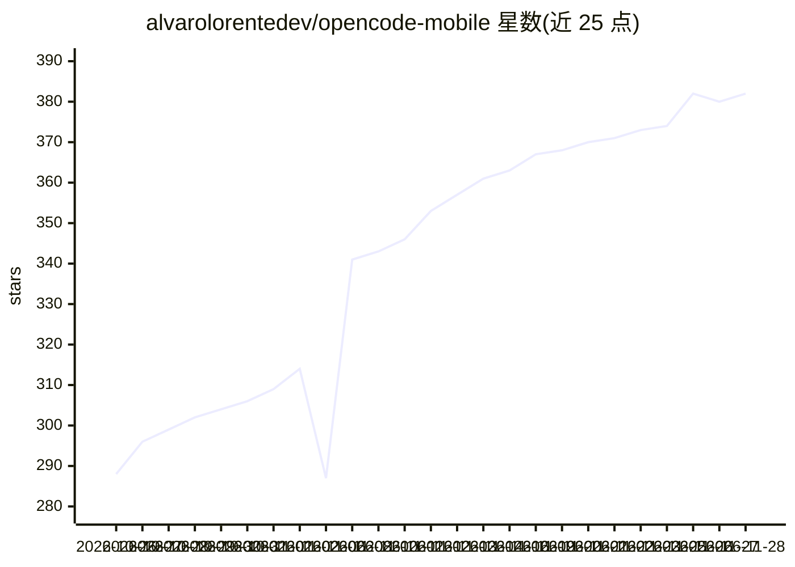

# alvarolorentedev/opencode-mobile

⭐ 382 · TypeScript · Apache-2.0 · 推送 2026-11-26 · [GitHub](https://github.com/alvarolorentedev/opencode-mobile) · [官网](https://getopencode.app/) · 个人维护

**远程连接 OpenCode 服务器的移动端 Agent 会话管理应用**

社区独立构建的移动端应用，连接自托管的 OpenCode 服务器：在手机上选择项目、worktree、agent 与模型后发送/fork/回退提示词，实时查看推理、工具调用、shell 输出与补丁，处理权限审批、查看 diff、打开终端，并支持语音口述提示与免提对话模式。代码保留在运行 OpenCode 的主机上，通过 LAN/VPN/HTTPS 隧道远程连接，使用 `opencode pair` 配对或扫码接入。Android 提供 Google Play 与 APK，iOS 经 TestFlight 分发；由 React Native/Expo/TypeScript 构建，非官方 OpenCode 产品。

## 筛选速览

| 维度 | 判定 | 备注 |
|---|---|---|
| AI 角色 | `ai-ecosystem` | LLM/agent 周边工具 |
| 许可风险 | `permissive` | Apache-2.0 |
| 部署形态 | `None` |  |
| 模型依赖 | — | README 未给出锁定关系 |
| 硬件要求 | — | 无带数字的原话,不猜 |
| 安装摩擦 | `low` | 无编译、无系统依赖或容器化 |
| 成熟度 | — | 结构信号不足 |

## 能力要点

- 手机端运行/引导/审批 OpenCode agent 会话并支持语音免提模式
- QR 扫码配对（链接 5 分钟一次性有效，连接持续 30 天）
- 配置 providers、模型、MCP 服务器、插件与 Flowgraph 可视化
- 代码留在自托管主机，支持多服务器/项目/会话管理

## 适用场景

- 离开电脑时在手机上跟进并引导 OpenCode agent 的任务进度
- 在外出途中审批 agent 的权限请求并检查代码 diff
- 用 VPN 或隧道安全访问家中/内网的 OpenCode 服务器

## 场景标签

`编码 Agent` · 领域:编码与开发

## 证据(README 行号)

> L23: OpenCode Mobile is an independent, community-built mobile companion for OpenCode.
> L25: It connects directly to individual OpenCode servers and can continue existing sessions. It gives you a focused mobi
> L45: - **Shape your setup** — providers, models, MCP servers, agents, commands, plugins, and visualizations like Flowgra

## 星数曲线

2026-10-26 288 → 2026-11-28 382（+94）

---
*卡片 v1 · prompt 1.4 · 生成 2026-11-27 · 置信度 high · 依据 README sha `cff367b8c85b` · [字段定义](../../DATASET.md)*
