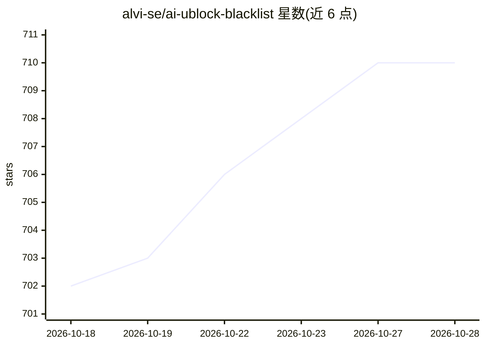

# alvi-se/ai-ublock-blacklist

⭐ 710 · Adblock Filter List · GPL-3.0 · 推送 2026-10-28 · [GitHub](https://github.com/alvi-se/ai-ublock-blacklist) · [官网](https://subscribe.adblockplus.org/?location=https%3A%2F%2Fraw%2Egithubusercontent%2Ecom%2Falvi%2Dse%2Fai%2Dublock%2Dblacklist%2Fmaster%2Flist%2Etxt&title=AI%20Content%20Farms) · 个人维护

**个人维护的 AI 内容农场屏蔽清单，供 uBlock Origin/uBlacklist 订阅**

由个人浏览网络时手动收录的 AI 生成内容农场域名清单，以 uBlock Origin 与 uBlacklist 订阅链接方式提供，导入后屏蔽相关网站。仓库以 JSON 格式组织条目（main/grouped/sheets 三类），接受 issue 与 pull request 补充。README 描述人工识别内容农场的若干模式（如空泛导语、无来源、推荐链接密集），并附 Google Dorks 与 SEO 反链表格（实验性）作为扩充来源。作者声明条目有意大利语网站偏倚，表格导入可能产生误报。

## 筛选速览

| 维度 | 判定 | 备注 |
|---|---|---|
| AI 角色 | `ai-knowledge` | 知识聚合/清单类 |
| 许可风险 | `viral` | GPL-3.0 |
| 部署形态 | `None` |  |
| 模型依赖 | — | README 未给出锁定关系 |
| 硬件要求 | — | 无带数字的原话,不猜 |
| 安装摩擦 | `low` | 无编译、无系统依赖或容器化 |
| 成熟度 | `idea` | |

## 能力要点

- 提供 uBlock Origin 与 uBlacklist 两种订阅方式
- 条目以 JSON 存储（main/grouped/sheets 三类），支持 PR 与 issue 提交
- 人工收录，未使用自动化检测工具
- 实验性支持从 SEO 反链 Google Spreadsheets 批量导入（标注误报风险）

## 适用场景

- 浏览网页时屏蔽 AI 生成的内容农场站点
- 通过 PR/issue 参与补充屏蔽条目
- 参考其内容农场识别模式与 Google Dorks 做类似筛选

## 场景标签

`精选清单` · 领域:学习与行业

## 证据(README 行号)

> L2: A personal list for uBlock Origin and uBlacklist blocking AI content farms. Pull requests welcome.
> L35: The repository stores the blocked sites in JSON format. All files are stored in

## 星数曲线

2026-10-18 702 → 2026-10-28 710（+8）

---
*卡片 v1 · prompt 1.4 · 生成 2026-10-21 · 置信度 high · 依据 README sha `b4c3a272ae93` · [字段定义](../../DATASET.md)*
