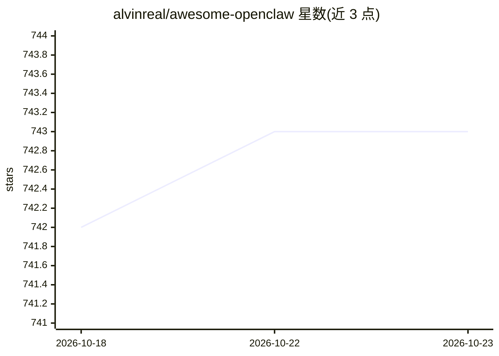

# alvinreal/awesome-openclaw

⭐ 743 · CC0-1.0 · 推送 2026-10-15 · [GitHub](https://github.com/alvinreal/awesome-openclaw) · [官网](https://clawisthelaw.com) · 个人维护 · 中文 README

**OpenClaw 生态资源策展清单：官方项目、技能、面板与部署工具**

面向 OpenClaw agent 框架使用者的 awesome 类策展清单：收录官方仓库（工作流 shell、Windows 伴侣套件、各类 CLI 与 MCP 工具）、技能注册平台、30 余个仪表盘与控制中心，以及自托管部署运维工具（Ansible、Nix、Homebrew、Kubernetes、Docker、Cloudflare Workers 等）。条目以链接加一句话描述形式组织，接受社区贡献，采用 CC0 许可，可在 clawisthelaw.com 浏览。

## 筛选速览

| 维度 | 判定 | 备注 |
|---|---|---|
| AI 角色 | `ai-knowledge` | 知识聚合/清单类 |
| 许可风险 | `viral` | CC0-1.0 |
| 部署形态 | `library` | 以包/库形式分发 |
| 模型依赖 | — | README 未给出锁定关系 |
| 硬件要求 | — | 无带数字的原话,不猜 |
| 安装摩擦 | `low` | 无编译、无系统依赖或容器化 |
| 成熟度 | — | 结构信号不足 |

## 能力要点

- 覆盖 30+ 官方仓库（CLI 工具、技能包、SDK cookbook 等）
- 收录技能注册平台与 5,400+ 技能的索引来源
- 收录大量自托管部署途径：Ansible/Nix/Kubernetes/Docker/Cloudflare Workers
- 收录 30 余个监控与管理仪表盘项目

## 适用场景

- 搭建 OpenClaw agent 环境时查找官方工具与部署方案
- 为 OpenClaw agent 寻找管理面板与监控方案
- 发现技能注册平台与社区扩展资源

## 场景标签

`精选清单` · 领域:学习与行业

## 证据(README 行号)

> L3:  A curated list of projects for the OpenClaw ecosystem. Individual skills are listed separately.
> L20: - openclaw/openclaw GitHub Repo stars - The core OpenClaw project.
> L65: - openclaw/clawhub GitHub Repo stars - Official skill and plugin registry.

## 星数曲线

2026-10-18 742 → 2026-10-23 743（+1）

---
*卡片 v1 · prompt 1.4 · 生成 2026-10-21 · 置信度 mid · 依据 README sha `56d63ca31131` · [字段定义](../../DATASET.md)*
