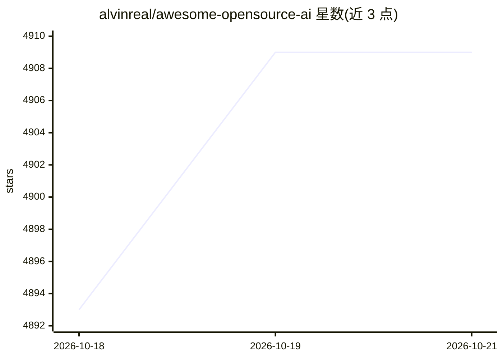

# alvinreal/awesome-opensource-ai

⭐ 4,909 · Python · CC0-1.0 · 推送 2026-10-19 · [GitHub](https://github.com/alvinreal/awesome-opensource-ai) · [官网](https://awesomeosai.com) · 个人维护

**开源 AI 项目精选清单：覆盖模型、框架与基础设施**

由个人维护的 awesome 类策展清单，收录开源 AI 模型、库、基础设施、数据工具与学习资源，按核心框架（深度学习/Rust/Julia）、高性能计算、NLP、数据处理等章节组织。收录不以 GitHub star 数为门槛，更看重维护状态、文档质量与生态价值；条目附一句话简介与许可证信息。面向正在选型或构建 AI 系统的开发者，用于浏览与发现项目。

## 筛选速览

| 维度 | 判定 | 备注 |
|---|---|---|
| AI 角色 | `ai-knowledge` | 知识聚合/清单类 |
| 许可风险 | `viral` | CC0-1.0 |
| 部署形态 | `self-host` | docker 或自建部署 |
| 模型依赖 | — | README 未给出锁定关系 |
| 硬件要求 | — | 无带数字的原话,不猜 |
| 安装摩擦 | `low` | 无编译、无系统依赖或容器化 |
| 成熟度 | — | 结构信号不足 |

## 能力要点

- 按框架、计算库、NLP、数据处理等类别组织条目
- 收录标准不以 star 数为门槛，强调维护与文档
- 条目附简介与开源许可证信息

## 适用场景

- 为 AI 项目选型时浏览框架与工具选项
- 了解不同语言（Python/Rust/Julia）的 ML 框架生态
- 查找数据处理与标注相关开源工具

## 场景标签

`精选清单` · 领域:学习与行业

## 证据(README 行号)

> L19: Awesome Open Source AI is a curated list of open-source projects for people building with AI.
> L21: The goal is to help readers find useful models, libraries, tools, infrastructure, datasets, and learning resources 

## 星数曲线

2026-10-18 4,893 → 2026-10-21 4,909（+16）

---
*卡片 v1 · prompt 1.4 · 生成 2026-10-20 · 置信度 mid · 依据 README sha `4a4b8b0a42a5` · [字段定义](../../DATASET.md)*
