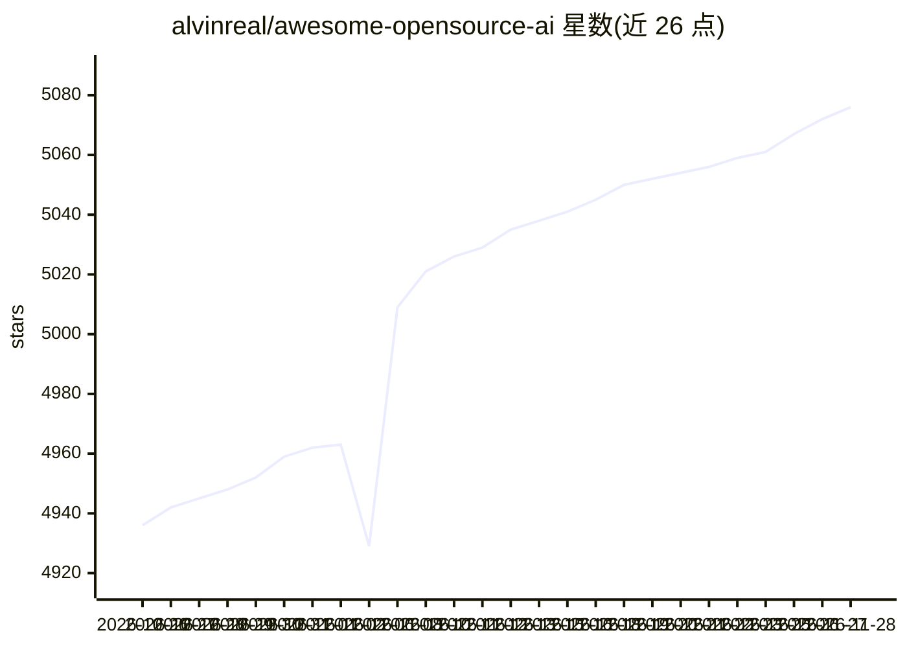

# alvinreal/awesome-opensource-ai

⭐ 5,076 · Python · CC0-1.0 · 推送 2026-11-27 · [GitHub](https://github.com/alvinreal/awesome-opensource-ai) · [官网](https://awesomeosai.com) · 个人维护

**面向 AI 开发者的开源 AI 项目策展清单，每日更新**

Awesome 系列清单，收录可用于构建、研究、运行、评估 AI 系统的开源模型、库、基础设施、数据集与学习资源。条目不设 star 门槛，收录标准是用途明确、维护良好、文档清晰或对 AI 生态某环节重要。按类别组织：深度学习框架（PyTorch/JAX/MLX）、高性能计算库、Rust/Julia ML 框架、NLP 工具、数据处理库等，每条附一句功能说明与许可证信息。

## 筛选速览

| 维度 | 判定 | 备注 |
|---|---|---|
| AI 角色 | `ai-knowledge` | 知识聚合/清单类 |
| 许可风险 | `viral` | CC0-1.0 |
| 部署形态 | `self-host` | docker 或自建部署 |
| 模型依赖 | — | README 未给出锁定关系 |
| 硬件要求 | — | 无带数字的原话,不猜 |
| 安装摩擦 | `low` | 无编译、无系统依赖或容器化 |
| 成熟度 | — | 结构信号不足 |

## 能力要点

- 按深度学习框架、高性能计算库、Rust/Julia ML、NLP、数据处理等类别组织条目
- 条目不设 star 门槛，附一句功能说明与许可证信息
- README 标注每日更新

## 适用场景

- 为 AI 项目选型时查找对应类别的开源工具
- 了解某个技术方向（如 Rust ML 框架）有哪些开源实现
- 寻找数据标注、数据版本控制等 ML 基础设施工具

## 场景标签

`精选清单` · 领域:学习与行业

## 证据(README 行号)

> L19: Awesome Open Source AI is a curated list of open-source projects for people building with AI.
> L21: The goal is to help readers find useful models, libraries, tools, infrastructure, datasets, and learning resources 
> L27: ## 1. Core Frameworks & Libraries

## 星数曲线

2026-10-26 4,936 → 2026-11-28 5,076（+140）

---
*卡片 v1 · prompt 1.4 · 生成 2026-11-28 · 置信度 mid · 依据 README sha `f60543cb057c` · [字段定义](../../DATASET.md)*
