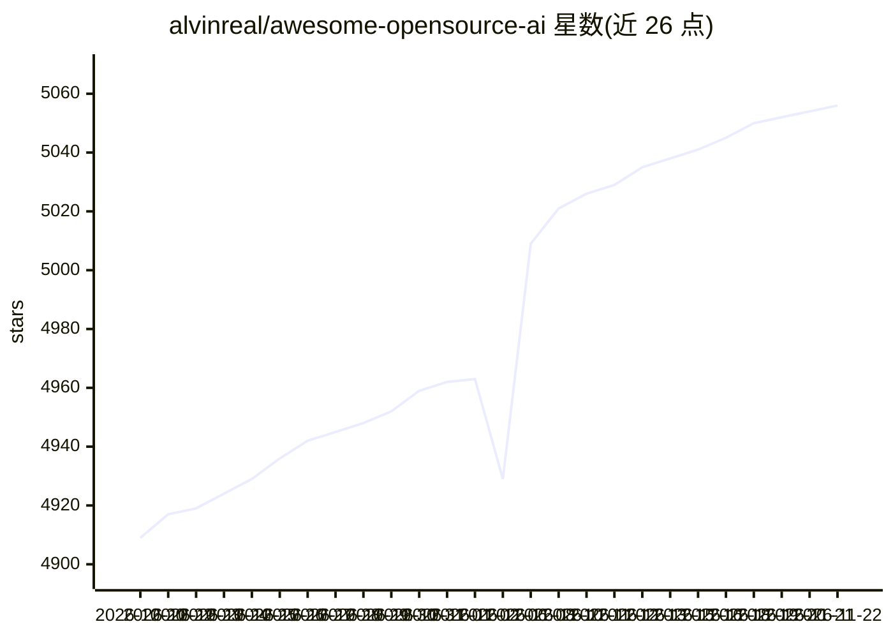

# alvinreal/awesome-opensource-ai

⭐ 5,056 · Python · CC0-1.0 · 推送 2026-11-06 · [GitHub](https://github.com/alvinreal/awesome-opensource-ai) · [官网](https://awesomeosai.com) · 个人维护

**面向 AI 构建者的开源模型、库与基础设施策展清单**

一份按类别组织的开源 AI 项目清单，收录模型、框架、库、基础设施、数据集与学习资源，收录标准不设 GitHub star 门槛，强调项目有明确存在理由并帮助人们构建、研究、运行、评测或理解 AI 系统。目录可见部分涵盖深度学习框架（PyTorch/JAX/MLX 等）、高性能计算库、Rust/Julia 框架、NLP 与 Transformers 库及数据处理工具，每条附一句定位描述与许可信息，每日更新维护。

## 筛选速览

| 维度 | 判定 | 备注 |
|---|---|---|
| AI 角色 | `ai-knowledge` | 知识聚合/清单类 |
| 许可风险 | `viral` | CC0-1.0 |
| 部署形态 | `self-host` | docker 或自建部署 |
| 模型依赖 | — | README 未给出锁定关系 |
| 硬件要求 | — | 无带数字的原话,不猜 |
| 安装摩擦 | `low` | 无编译、无系统依赖或容器化 |
| 成熟度 | — | 结构信号不足 |

## 能力要点

- 按类别组织的开源 AI 项目策展清单，覆盖框架/库/基础设施/数据集
- 收录不设 star 门槛，以有用性、维护状态、技术价值为标准
- 条目附一句话定位与许可证信息（如 Apache-2.0/MIT）
- 涵盖多语言生态：Python、Rust、Julia、C/C++ 框架均有收录

## 适用场景

- 为 AI 项目选型时查找对应类别的开源工具与框架
- 了解开源 AI 生态各细分领域有哪些可用项目
- 寻找数据集与学习资源入门某个 AI 方向

## 场景标签

`精选清单` · 领域:学习与行业

## 证据(README 行号)

> L19: Awesome Open Source AI is a curated list of open-source projects for people building with AI.
> L21: The goal is to help readers find useful models, libraries, tools, infrastructure, datasets, and learning resources 
> L27: ## 1. Core Frameworks & Libraries

## 星数曲线

2026-10-20 4,909 → 2026-11-22 5,056（+147）

---
*卡片 v1 · prompt 1.4 · 生成 2026-11-22 · 置信度 mid · 依据 README sha `b7244b03bd74` · [字段定义](../../DATASET.md)*
