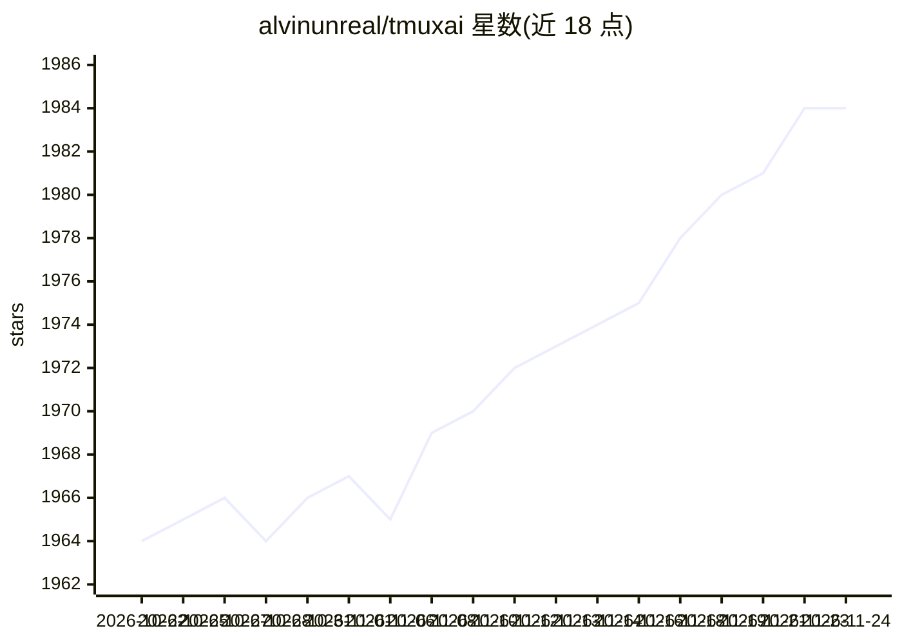

# alvinunreal/tmuxai

⭐ 1,984 · Go · Apache-2.0 · 推送 2026-11-21 · [GitHub](https://github.com/alvinunreal/tmuxai) · [官网](https://tmuxai.dev) · 组织维护

**tmux 会话内的终端 AI 助手：读取面板内容并代执行命令**

运行于 tmux 内的终端助手，读取当前窗口所有可见面板内容作为上下文，通过独立 Chat 面板交互，并可在指定 Exec 面板中经用户确认后执行命令。支持 Observe（默认，按 wait_interval 轮询）、Prepare（定制 shell 提示符精确跟踪命令，支持 bash/zsh/fish）与 Watch（按设定目标持续监视并给建议）三种模式，附带上下文压缩（squash）、Markdown 知识库加载、多行外部编辑器输入。配置模型 provider 后运行，系统仅需 tmux，支持 Linux 与 macOS。

## 筛选速览

| 维度 | 判定 | 备注 |
|---|---|---|
| AI 角色 | `ai-ecosystem` | LLM/agent 周边工具 |
| 许可风险 | `permissive` | Apache-2.0 |
| 部署形态 | `desktop` | 安装包/桌面程序 |
| 模型依赖 | locked-api |  |
| 硬件要求 | — | 无带数字的原话,不猜 |
| 安装摩擦 | `low` | 无编译、无系统依赖或容器化 |
| 成熟度 | — | 结构信号不足 |

## 能力要点

- 读取 tmux 全部可见面板内容作为上下文，不改变用户工作流
- Observe/Prepare/Watch 三种模式与命令白名单/黑名单及确认机制
- squash 上下文压缩与 /info 查看上下文占用
- Markdown 知识库可手动或启动时自动加载

## 适用场景

- 在 tmux 里让 AI 读懂当前多面板工作内容并给出命令建议
- 持续监视终端输出，提示错误或更简洁的命令
- 加载团队知识库让助手了解项目工作流约定

## 场景标签

`AI 助手` · 领域:对话与助手

## 证据(README 行号)

> L31: TmuxAI is an intelligent terminal assistant that lives inside your tmux sessions. Unlike other CLI AI tools, TmuxAI
> L83: TmuxAI reads its configuration from `~/.config/tmuxai/config.yaml`. To get running, create the file with a model en
> L97:        provider: openrouter  # openrouter, requesty, openai or azure

## 星数曲线

2026-10-22 1,964 → 2026-11-24 1,984（+20）

---
*卡片 v1 · prompt 1.4 · 生成 2026-11-23 · 置信度 mid · 依据 README sha `d402b095d3ff` · [字段定义](../../DATASET.md)*
